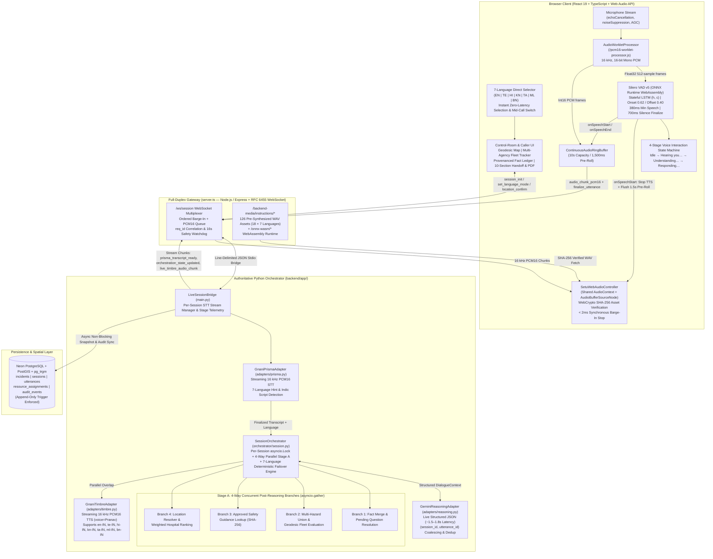
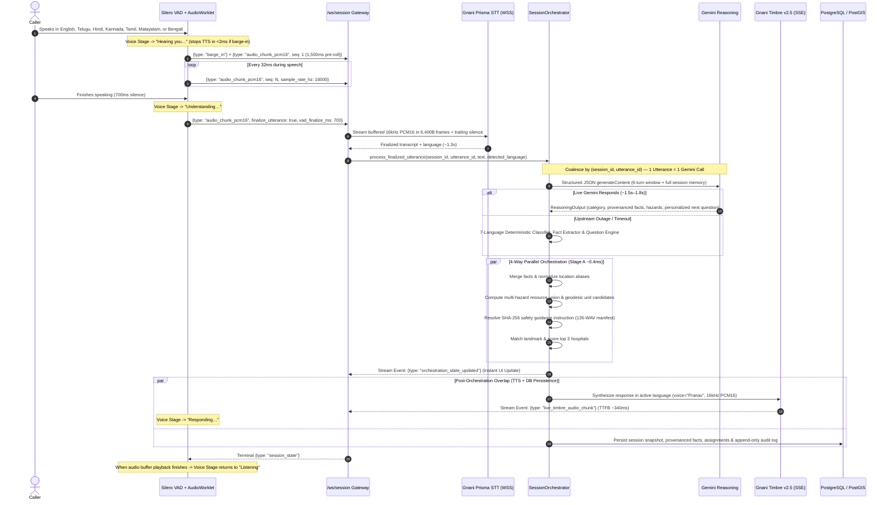

# SETHU.ai — Real-Time Multilingual Voice-First Emergency Coordination Platform

[](#)
[](#)
[](#)
[](#)
[-8E75B2)](#)
[](#)
[](#)
[-22C55E)](#)

> **PROTOTYPE DISCLOSURE (NOT 112):** SETHU.ai is an emergency coordination research and systems-engineering prototype built for India's multilingual emergency intake workflows (**English**, **Telugu — తెలుగు**, **Hindi — हिन्दी**, **Kannada — ಕನ್ನಡ**, **Tamil — தமிழ்**, **Malayalam — മലയാളം**, **Bengali — বাংলা**, plus **Tanglish**, **Hinglish**, and **Romanised Benglish**). It does **not** replace India's official **112** emergency service and is not connected to real-world emergency dispatch. All vehicles, availability, assignments, and ETAs are strictly simulated.

---

## Why This Project Exists (In Plain English — Understandable in 60 Seconds)

Imagine someone witnessing a severe road accident or fire in India. They are panicking, speaking fast in their native language—or mixing two languages mid-sentence (*"Madhapur Metro daggara road accident ayyindi, two people are bleeding!"*). Sirens and street noise are loud in the background.

If they call a traditional automated system or a standard AI chatbot, three things go wrong:
1. **Rigid menus waste life-saving seconds:** *"Press 1 for Police, Press 2 for Ambulance..."* or asking *"Is anyone injured?"* right after the caller already said *"two people are bleeding."*
2. **Standard AI chatbots are unsafe for emergencies:** A generic LLM can hallucinate (*"I have dispatched a real ambulance"*), forget an earlier detail during a long call, or freeze completely if the AI API experiences a network spike.
3. **Standard web audio cannot handle real human interruption:** When a panicking caller interrupts the assistant mid-sentence (**barge-in**), ordinary web apps either talk over the caller or cut off the first second of what the caller just said.

**SETHU.ai ("Setu" = Bridge)** was engineered from first principles to solve all three problems:
- **It listens like a human:** Captures raw `16 kHz` audio in the browser, keeps a rolling **1.5-second pre-roll memory** so the first syllable is never lost, and stops speaking in **under 2 milliseconds** the instant the caller interrupts.
- **It understands 7 Indian languages + code-mixed speech:** Supports **English, Telugu, Hindi, Kannada, Tamil, Malayalam, and Bengali** end-to-end—and lets the caller switch languages mid-call without losing a single detail of the ongoing incident.
- **It pairs AI intelligence with strict deterministic safety rules:** Gemini extracts structured facts (with exact quote evidence and utterance IDs) and crafts empathetic follow-up questions in **~1.5–1.8 seconds**, while deterministic Python engines control **multi-hazard vehicle dispatch**, **GPS/landmark verification**, **geodesic hospital ranking**, and **126 pre-verified safety audio instructions**. Even if the cloud AI goes offline, SETHU.ai automatically fails over to a deterministic multilingual engine so an emergency call **never** stalls.

---

## Recruiter & Engineering Manager Snapshot — Why This Is Production-Grade Systems Engineering

This repository is not a thin wrapper around an LLM prompt. Every layer is purposefully engineered, benchmarked, and verified by **76 automated tests**:

| Engineering Domain | What Was Built (No Shortcuts) | Concrete Proof in This Repo |
| :--- | :--- | :--- |
| **Real-Time Browser Audio DSP & ONNX WASM** | Custom `16 kHz` mono `AudioWorkletProcessor`, `10s` circular PCM ring buffer (`1,500 ms` pre-roll), and in-browser **Silero VAD v5** running on WebAssembly (`onnxruntime-web`) with LSTM state tensors (`h, c`) and hysteresis recovery. | `public/pcm16-worklet-processor.js`<br>`src/utils/sileroVad.ts`<br>`src/utils/audioPipeline.ts` |
| **Sub-2ms Barge-In & Cryptographic Audio** | Shared `AudioContext` + `AudioBufferSourceNode` scheduler that halts active playback in **`< 2 ms`** on caller interruption and verifies all **126 pre-synthesized safety WAVs** against a **WebCrypto SHA-256 checksum manifest** before playback. | `src/utils/audioPipeline.ts`<br>`backend-media/instructions/manifest.json` |
| **Deterministic 4-Stage Voice UX State Machine** | Pure, race-condition-free state machine (`Idle` $\rightarrow$ `Hearing you…` $\rightarrow$ `Understanding…` $\rightarrow$ `Responding…` $\rightarrow$ `Listening`) synchronized with live mic RMS energy, VAD probability, and TTS playback completion. | `src/utils/setuEngine.ts`<br>`src/utils/setuEngine.test.ts` |
| **LLM Reliability, Coalescing & Token Engineering** | Enforces **`1 Unique Finalized Utterance = 1 Gemini Request`** via `(session_id, utterance_id)` `asyncio.Future` coalescing + LRU deduplication. Bounds verbatim prompt window to 6 turns while retaining 100% of structured session memory (**-46.0% prompt tokens**). | `backend/app/adapters/reasoning.py`<br>`backend/tests/test_gemini_usage_and_performance_optimization.py` |
| **Low-Latency Parallel AsyncIO Orchestration** | Executes 4 post-reasoning branches concurrently via `asyncio.gather` in **`~0.4 ms`** (fact merge, multi-hazard fleet union, SHA-256 safety lookup, hospital scoring), then overlaps **Gnani Timbre v2.5 SSE TTS** (`~340 ms` TTFB) with **PostgreSQL/PostGIS writes**. | `backend/app/orchestrator/session.py`<br>`backend/app/main.py` |
| **7-Language Indian Localization & Zero-Loss Switching** | Direct one-click selection and mid-call language switching across **EN, TE, HI, KN, TA, ML, BN** (plus Tanglish/Hinglish/Benglish) with **126 native Timbre WAVs** (18 instructions × 7 languages) and zero session-state reset on switch. | `backend/tests/test_seven_language_autodetect.py`<br>`backend/app/orchestrator/announcements.py` |
| **Geospatial Dispatch & Immutable Compliance Audit** | PostGIS `GEOGRAPHY(POINT, 4326)` spatial indexing, `pg_trgm` fuzzy landmark resolution, Haversine nearest-fleet allocation across 9 emergency categories, and PostgreSQL triggers blocking `UPDATE`/`DELETE` on `audit_events`. | `backend/migrations/0001_initial_setu_schema.sql`<br>`backend/app/orchestrator/dispatch.py` |

---

## Table of Contents

1. [How a Call Works Step-by-Step (Concrete Example)](#1-how-a-call-works-step-by-step-concrete-example)
2. [End-to-End System Architecture](#2-end-to-end-system-architecture)
3. [Real-Time Voice, Silero VAD & Acoustic Pipeline Internals](#3-real-time-voice-silero-vad--acoustic-pipeline-internals)
4. [Seven-Language Support & 126 Cryptographically Verified Safety WAVs](#4-seven-language-support--126-cryptographically-verified-safety-wavs)
5. [Gemini Reasoning Engine, Adaptive Thinking & Lossless Session Memory](#5-gemini-reasoning-engine-adaptive-thinking--lossless-session-memory)
6. [Deterministic Safety Invariants, Multi-Hazard Dispatch & Hospital Ranking](#6-deterministic-safety-invariants-multi-hazard-dispatch--hospital-ranking)
7. [Control-Room Workspace & Engineering Diagnostics Walkthrough](#7-control-room-workspace--engineering-diagnostics-walkthrough)
8. [Database Schema, PostGIS Spatial Indexing & Append-Only Audit Ledger](#8-database-schema-postgis-spatial-indexing--append-only-audit-ledger)
9. [Measured Benchmarks & Token Optimization Results](#9-measured-benchmarks--token-optimization-results)
10. [Repository Structure](#10-repository-structure)
11. [Quickstart, Verification & Test Suite](#11-quickstart-verification--test-suite)
12. [Hackathon Award Track & Judging Matrix](#12-hackathon-award-track--judging-matrix)

---

## 1. How a Call Works Step-by-Step (Concrete Example)

To understand how all subsystems work together, trace a single real-time turn when a caller speaks:

1. **Caller selects a language & starts the session:**
   - The caller taps any of the **7 direct language cards** (`English`, `Telugu — తెలుగు`, `Hindi — हिन्दी`, `Kannada — ಕನ್ನಡ`, `Tamil — தமிழ்`, `Malayalam — മലയാളം`, `Bengali — বাংলা`) and clicks **Start Live Voice Session**.
   - SETHU unlocks the Web Audio pipeline and plays the SHA-256 verified prototype disclosure in the selected language.
2. **Caller speaks (`"Hearing you…"`):**
   - *"A lorry carrying gas cylinders collided with a bus near Charminar, fire broke out and two people are injured!"*
   - The browser `AudioWorklet` streams `16 kHz` 16-bit mono PCM frames into a `10s` circular ring buffer while in-browser **Silero VAD v5 (ONNX)** tracks speech probability in real time.
3. **Caller finishes speaking (`"Understanding…"`):**
   - After `700 ms` of post-speech silence, Silero VAD finalizes the utterance. The UI immediately transitions from **Hearing you…** to **Understanding…**.
   - Buffered PCM audio (including `1,500 ms` of pre-roll before speech onset) streams over `/ws/session` to **Gnani Prisma WSS STT**, returning the finalized transcript.
4. **Single-Call Structured Reasoning (`~1.5–1.8s`):**
   - `SessionOrchestrator` coalesces the request by `(session_id, utterance_id)` and invokes `GeminiReasoningAdapter`.
   - In a **single** structured JSON pass, Gemini:
     - Classifies the emergency as `fire_with_injuries` (`confidence: 0.95`),
     - Extracts provenanced facts (`caller_location_text="Charminar"`, `injuries_reported=true`, `affected_person_count=2`) citing the exact `utterance_id` and substring quote,
     - Identifies compound hazards `["vehicle_collision", "fire", "gas_cylinder", "injuries"]`,
     - Sees that injury count and location are already answered—so instead of asking redundant questions, it asks the highest-priority missing safety question: *"Are you and others at a safe distance away from the gas cylinders?"*
5. **4-Way Parallel Post-Reasoning Orchestration (`~0.4 ms`):**
   - Concurrently via `asyncio.gather`:
     - **Branch 1** merges facts into session memory and updates question history.
     - **Branch 2** computes the multi-hazard resource union (`fire_engine` + `ambulance` + `police_patrol`) and selects the nearest available synthetic units by Haversine distance.
     - **Branch 3** selects the reviewed LPG/fire safety instruction (`safety_fire_01`) and verifies its SHA-256 WAV checksum.
     - **Branch 4** matches `"Charminar"` (`17.3616, 78.4747`) in the synthetic landmark directory and scores the top 3 trauma/burn hospitals.
6. **Spoken Response & Map Update (`"Responding…"` $\rightarrow$ `"Hearing you…"`):**
   - **Gnani Timbre v2.5 SSE TTS** streams the spoken response (`TTFB ~340 ms`) while PostgreSQL persists the state snapshot and append-only audit log in parallel.
   - As audio plays, the UI transitions to **Responding…**, displays the live moving vehicles on the MapLibre/Leaflet map, and automatically returns to **Listening** the moment playback completes.

---

## 2. End-to-End System Architecture

### 2.1 High-Level Component Architecture



---

### 2.2 Live Voice Turn Sequence Diagram



---

## 3. Real-Time Voice, Silero VAD & Acoustic Pipeline Internals

### 3.1 `16 kHz` AudioWorklet, `1,500 ms` Pre-Roll Ring Buffer & Silero VAD v5
- **Dedicated Audio Thread Capture (`public/pcm16-worklet-processor.js` & `src/utils/audioPipeline.ts`)**:
  - Captures microphone audio with `echoCancellation: true`, `noiseSuppression: true`, and `autoGainControl: true`.
  - Downsamples and frames audio into `16,000 Hz`, 16-bit signed little-endian mono PCM (`512` samples = `32 ms` per frame) and computes real-time RMS energy and clipping telemetry.
  - Pushes every frame into `ContinuousAudioRingBuffer` (`10,000 ms` capacity, `320 KB` bounded memory) and `SileroVadDetector` (`src/utils/sileroVad.ts`).
- **In-Browser Silero VAD v5 (`public/models/silero_vad.onnx`)**:
  - Executes ONNX Runtime WebAssembly (`onnxruntime-web`) directly in the browser with stateful LSTM tensors (`h` and `c` of shape `[2, 1, 64]`).
  - **Hysteresis & Noise Recovery**:
    - `positiveSpeechThreshold = 0.62` (speech onset)
    - `negativeSpeechThreshold = 0.40` (speech offset)
    - **Hysteresis-band decay (`0.40 – 0.62`)**: Moderate ambient street noise between `0.40` and `0.62` increments silence frames at `0.5×` rate instead of resetting silence counters to zero—guaranteeing the detector never gets stuck in `"Hearing you…"` in noisy environments.
    - `minSpeechDurationMs = 380` rejects brief clicks, coughs, and desk knocks locally (`onVADMisfire`) so **zero** API calls are wasted on non-speech noise.
    - `silenceTimeoutMs = 700` finalizes the utterance cleanly after `700 ms` of post-speech silence.

### 3.2 State-Aware 4-Stage Voice Interaction Lifecycle (`src/utils/setuEngine.ts`)
The voice indicator transitions deterministically across four user-visible stages via `transitionVoiceInteractionState`:
1. **`listening` ("Hearing you…")**: Active while Silero VAD detects ongoing caller speech (`speech_started`), with mic-level reactive waveform bars.
2. **`understanding` ("Understanding…")**: Triggered immediately on `speech_finalized` or text submission; displays a focused pulse animation while STT finalization, Gemini reasoning, and 4-way parallel orchestration run.
3. **`responding` ("Responding…")**: Triggered on `response_audio_started` when `SetuWebAudioController` begins playing Timbre TTS or verified safety WAV audio.
4. **Return to `listening` / `idle`**: Triggered on `response_audio_ended` when the final `AudioBufferSourceNode` completes playback (or immediately on `barge_in` / `turn_error_or_timeout` via a safety watchdog).

### 3.3 Mandatory 3-Step Barge-In Protocol (`< 2 ms` Local Stop)
Whenever the caller speaks while assistant audio is playing:
1. **Step 1 (Synchronous Local Stop)**: `SetuWebAudioController.stopPlaybackImmediately()` increments `playbackGeneration`, disconnects and stops all active `AudioBufferSourceNode` instances in **`0.2 ms – 1.5 ms`**, and cancels any pending async WAV decode.
2. **Step 2 (Queue Purge)**: Clears all queued TTS chunks on the client.
3. **Step 3 (Ordered Server Notification + Pre-Roll Flush)**: Sends `{ type: "barge_in" }` followed immediately by `{ type: "audio_chunk_pcm16", sequence_number: 1 }` containing the **`1,500 ms` pre-roll** from `ContinuousAudioRingBuffer`.

---

## 4. Seven-Language Support & 126 Cryptographically Verified Safety WAVs

SETHU.ai supports **seven Indian languages** directly from the Session Start screen and live coordination bar—requiring **zero** voice-identification wait time before an emergency call begins:

| Language | ISO Code | Native Script Label | Gnani Prisma STT Locale | Gnani Timbre v2.5 TTS Voice | Pre-Synthesized Safety WAVs |
| :--- | :---: | :--- | :---: | :---: | :---: |
| **English (India)** | `en` | **English (IN) — English** | `en-IN` | `Pranav` (`16 kHz` mono) | `18 / 18` SHA-256 verified |
| **Telugu** | `te` | **Telugu — తెలుగు** | `te-IN` | `Pranav` (`16 kHz` mono) | `18 / 18` SHA-256 verified |
| **Hindi** | `hi` | **Hindi — हिन्दी** | `hi-IN` | `Pranav` (`16 kHz` mono) | `18 / 18` SHA-256 verified |
| **Kannada** | `kn` | **Kannada — ಕನ್ನಡ** | `kn-IN` | `Pranav` (`16 kHz` mono) | `18 / 18` SHA-256 verified |
| **Tamil** | `ta` | **Tamil — தமிழ்** | `ta-IN` | `Pranav` (`16 kHz` mono) | `18 / 18` SHA-256 verified |
| **Malayalam** | `ml` | **Malayalam — മലയാളം** | `ml-IN` | `Pranav` (`16 kHz` mono) | `18 / 18` SHA-256 verified |
| **Bengali** | `bn` | **Bengali — বাংলা** | `bn-IN` | `Pranav` (`16 kHz` mono) | `18 / 18` SHA-256 verified |

- **126 Pre-Synthesized Safety WAV Assets (`18 instructions × 7 languages`)**:
  - Every emergency category (medical, CPR/unconscious, severe bleeding, road accident, fire, LPG gas leak, building collapse, physical attack, disclosure, outage reassurance, silence check-ins) has a pre-reviewed native translation and a `16 kHz` mono PCM WAV file in `backend-media/instructions/<lang>/<instruction_id>/v1.0.wav`.
  - Before playing any cached safety WAV, the browser computes `crypto.subtle.digest('SHA-256', arrayBuffer)` and verifies it against `backend-media/instructions/manifest.json`.
- **Seamless Mid-Call Language Switching**:
  - Clicking any of the 7 language pills during an active call (`set_language_mode`) switches STT, Gemini prompt language, deterministic fallback responses, safety audio, and Timbre TTS immediately—while preserving `incident_id`, `validated_facts`, confirmed location, transcript history, and dispatched units.

---

## 5. Gemini Reasoning Engine, Adaptive Thinking & Lossless Session Memory

### 5.1 Strict Request Identity: `1 Unique Finalized Utterance = 1 Gemini Request`
Implemented in `GeminiReasoningAdapter` (`backend/app/adapters/reasoning.py`):
- **In-Flight Coalescing**: Concurrent requests for the same `(session_id, utterance_id)` attach to a single in-flight `asyncio.Future[ReasoningOutput]`.
- **Retransmission Deduplication**: A bounded `512`-entry LRU cache keyed strictly by `(session_id, utterance_id)` returns completed outputs in `0.1 ms` on WebSocket retry.
- **Single-Attempt Timeout Policy**: Timeouts (`HTTP 408` / `asyncio.TimeoutError`) are marked `is_retryable=False` so a slow network turn never fires a duplicate back-to-back Gemini request.
- **No Text-Based False Deduplication**: Answering `"Yes"` to two different follow-up questions on Turn 2 and Turn 4 carries distinct `utterance_id` UUIDs and always executes independent reasoning turns.

### 5.2 Structured Diagnostic Classification & Live Verification
- `classify_gemini_diagnostic_failure` categorizes any provider error into explicit, non-secret diagnostic codes (`ok`, `timeout_exceeded`, `http_400_invalid_request_or_model`, `http_401_403_auth_or_key_invalid`, `http_404_model_not_found`, `http_429_rate_limit_or_quota`, `http_5xx_upstream_unavailable`, `provider_blocked_content`, `schema_validation_failed`) surfaced in `provider_status.gemini`.
- Location field aliases returned by Gemini (`location`, `landmark`, `caller_landmark`, `address`, `incident_location`) are automatically normalized to `caller_location_text` so spoken landmarks resolve immediately on the first turn.

### 5.3 Lossless Session Memory with Bounded 6-Turn Prompting
- **Complete Authoritative State (`IncidentSessionState`)**: Retains every `ProvenancedFact` (with `source_utterance_id` and exact quote `evidence_text`), `superseded_facts`, `conflicts`, `question_history`, `identified_hazards`, and active unit assignments across the entire call.
- **Compact Prompt Builder (`build_compact_dialogue_prompt`)**: Serializes the complete structured memory JSON + `Confirmed/Answered Fields (DO NOT RE-ASK)` + a **bounded 6-turn verbatim conversation window** (`MAX_RECENT_CONVERSATION_TURNS = 6`) + a compact provenance index for older turns—cutting prompt tokens by **46.0%** on 12-turn calls with **0% memory loss**.

---

## 6. Deterministic Safety Invariants, Multi-Hazard Dispatch & Hospital Ranking

### 6.1 Nine-Category Emergency Taxonomy & Multi-Hazard Resource Union (`backend/app/orchestrator/dispatch.py`)

All dispatch allocations are governed by deterministic Python rules—never by raw LLM text:

| Emergency Category | Base Required Synthetic Units | Compound Hazard Additive Upgrade Rule |
| :--- | :--- | :--- |
| `medical_emergency` | `ambulance` | + `fire_engine` if `fire`/`gas_cylinder` co-occurs; + `police_patrol` if `vehicle_collision`/`assault` co-occurs |
| `fire` | `fire_engine` | Automatically upgrades to `fire_with_injuries` (`fire_engine` + `ambulance`) if `injuries_reported=true` |
| `fire_with_injuries` | `fire_engine`, `ambulance` | + `police_patrol` if `vehicle_collision`, `gas_cylinder`, or `explosion` is present |
| `road_accident` | `ambulance`, `police_patrol` | + `fire_engine` if `fire` or `gas_cylinder` is reported; + `fire_and_rescue` if `trapped_persons` reported |
| `building_collapse` | `fire_and_rescue`, `ambulance`, `police_patrol` | Full multi-agency rescue response |
| `physical_attack` | `police_patrol` | + `ambulance` if `injuries_reported=true` |
| `gas_leak` | `fire_engine`, `police_patrol` | + `ambulance` if `injuries_reported=true` or `unconscious` |
| `explosion` | `fire_engine`, `ambulance`, `police_patrol` | + `fire_and_rescue` if `building_collapse` or `trapped_persons` co-occurs |
| `unknown` | `ambulance` *(after 2 consecutive unknowns or 3 safety blocks)* | Flags `control_room_review_required=true` (single-application guarantee) |

### 6.2 Location Confirmation Gate & Geodesic Hospital Ranking
- **GPS & Multilingual Landmark Resolution (`backend/app/orchestrator/location.py`)**:
  - Accepts browser GPS coordinates when accuracy `<= 500 m` or resolves spoken landmarks (*Charminar*, *HITEC City*, *Madhapur Metro*, *Secunderabad Station*, *Gachibowli*, *Banjara Hills*, *Kukatpally*, *LB Nagar*, *Ameerpet*, *Jubilee Hills*) via trigram similarity across English and Indian-script aliases.
  - Units remain in `pending_location` until the caller confirms the location pin (via map button or voice), then transition through **`ASSIGNED` $\rightarrow$ `EN_ROUTE` $\rightarrow$ `ARRIVED`**.
- **Deterministic Hospital Ranking (`backend/app/orchestrator/hospital.py`)**:
  - Scores candidate hospitals by geodesic distance and trauma/burn/cardiac capability fit, automatically re-normalizing weights (`0.625` distance / `0.375` capability) when live traffic ETA is unavailable:

$$\text{Final Score} = w_{\text{dist}} \cdot \max\left(0, 1 - \frac{d_{\text{km}}}{25.0}\right) + w_{\text{cap}} \cdot \frac{|\text{Matched Capabilities}|}{|\text{Required Capabilities}|}$$

---

## 7. Control-Room Workspace & Engineering Diagnostics Walkthrough

```
┌──────────────────────────────────────────────────────────────────────────────────────────────────────┐
│  PROTOTYPE DISCLOSURE BANNER: SETHU.ai is a simulation prototype (NOT connected to 112).             │
├──────────────────────────────────────────────────────────────────────────────────────────────────────┤
│  HEADER: [SETHU.ai] | Incident & Session ID | Lang: EN/TE/HI/KN/TA/ML/BN | [Live Incident] [Handoff] │
├───────────────────────────────────────────────┬──────────────────────────────────────────────────────┤
│  LEFT COLUMN: LIVE VOICE & CALLER COORDINATION│  RIGHT COLUMN: GEODESIC MAP, FLEET & TRIAGE LEDGER   │
│                                               │                                                      │
│  1. Coordination Progress Stepper             │  1. Interactive MapLibre / Geodesic Map (Hyderabad)  │
│     [Listening]→[Understanding]→[Locating]    │     • Caller GPS / Landmark Pin (±accuracy circle)   │
│     →[Assigning]→[Guiding]                    │     • Live Moving Vehicle Markers (AMB / FIR / POL)  │
│                                               │     • One-Tap [Confirm Location] Gate Banner         │
│  2. 4-Stage Voice Interaction Surface         │                                                      │
│     • Stage Badge: Hearing you… /             │  2. Simulated Unit Assignments & Fleet Roster        │
│       Understanding… / Responding…            │     • Callsign, Geodesic Distance (m), Live ETA      │
│     • 7 Direct Language Switcher Pills        │     • Lifecycle Badge: ASSIGNED → EN_ROUTE → ARRIVED │
│     • Silero VAD Probability & Mic RMS Meter  │                                                      │
│     • Live Transcript & Pending Question Card │  3. Provenanced Fact Ledger & Conflict Audit         │
│                                               │     • Active Facts with Utterance UUID & Quote       │
│  3. Approved Safety Guidance Card             │     • Superseded / Conflicting Statements Highlight  │
│     • NDMA / Red Cross / WHO Attribution      │     • Simultaneous Active Hazard Badges              │
│     • WebCrypto SHA-256 Verified Checksum     │                                                      │
│                                               │  4. Deterministic Hospital Ranking Breakdown         │
│  4. Stage-by-Stage Latency Waterfall          │     • Top-3 Hospitals with Distance & Capability     │
│     • VAD → Prisma STT → Gemini → Orch → TTS  │       Component Score Contributions                  │
└───────────────────────────────────────────────┴──────────────────────────────────────────────────────┘
```

- **Isolated 8 kHz Telephony & Street Noise Bench (Engineering Diagnostics)**:
  - Inside the **Engineering Diagnostics** overlay, engineers can run an isolated `8 kHz` narrowband G.711 telephony + `-18 dBFS` street/siren noise simulation (`300 Hz – 3,400 Hz` bandpass) that benchmarks Silero VAD noise frame rejection without touching live microphone audio, real incidents, or ambulance dispatch.

---

## 8. Database Schema, PostGIS Spatial Indexing & Append-Only Audit Ledger

Defined in `backend/migrations/0001_initial_setu_schema.sql` and managed at runtime by `NeonPostgresStore` (`backend/app/db/pool.py`):
- **`incidents`**: Stores `incident_id`, `current_category`, `category_confidence`, `location_point` (`GEOGRAPHY(POINT, 4326)`), `location_confirmed`, `unknown_fallback_applied`, `control_room_review_required`, and `review_reason_codes` (`JSONB`).
- **`sessions`**: Tracks `session_id`, `incident_id`, `session_state`, `active_language`, `revision`, and `last_event_sequence`.
- **`utterances`**: Immutable caller transcript records with `utterance_id`, `sequence_number`, `text`, `detected_language`, and `utterance_role`.
- **`resource_assignments`**: Idempotent unit allocations enforced by `UNIQUE (incident_id, idempotency_key)`.
- **`audit_events`**: Append-only compliance ledger protected by PostgreSQL trigger `trg_audit_events_immutable` (`prevent_audit_events_mutation()`), which blocks `UPDATE` and `DELETE` at the database engine level.

---

## 9. Measured Benchmarks & Token Optimization Results

### 9.1 Prompt Token Optimization (12-Turn Emergency Call)

| Metric | Legacy Unoptimized Baseline | Optimized SETHU.ai Pipeline | Measured Improvement |
| :--- | :--- | :--- | :--- |
| **Total Prompt Tokens (12-Turn Session)** | `7,940` tokens | `4,288` tokens | **-46.0% token reduction** (`3,652` tokens saved/session) |
| **Turn 12 Prompt Size (Long Call Scaling)** | `1,158` tokens | `519` tokens | **-55.2% reduction** on late-session turns |
| **Duplicate / Retransmission LLM Calls** | Unbounded on retry/misfire | `0` duplicate calls (`0.1 ms` cache hit) | **100% duplicate call elimination** |
| **Session Fact & Provenance Recall** | Truncation-prone | `100%` (all facts + UUID provenance retained) | **Zero memory loss across entire session** |

### 9.2 Measured Live End-to-End Voice Turn Latencies

| Pipeline Stage | Measured Latency | Notes |
| :--- | :--- | :--- |
| **Local Barge-In Audio Stop (`stopPlaybackImmediately`)** | **`1.1 ms`** | Synchronous `AudioBufferSourceNode` disconnect |
| **Silero VAD Post-Speech Silence Finalization** | **`700.0 ms`** | Configurable post-speech silence window |
| **Gnani Prisma Live WSS STT Finalization** | **`1,330.8 ms`** | `16 kHz` mono PCM16 streaming |
| **Live Gemini Structured JSON Reasoning** | **`1,596 ms – 1,835 ms`** | Single-call classification + fact extraction + next question |
| **4-Way Parallel Post-Reasoning Orchestration (`Stage A`)** | **`0.4 ms – 1.9 ms`** | `asyncio.gather` across 4 branches |
| **Gnani Timbre v2.5 Live TTS Time-To-First-Audio-Byte** | **`339.7 ms – 764.4 ms`** | Overlapped concurrently with non-blocking DB persistence |

---

## 10. Repository Structure

```text
├── .env.example                          # Documented environment variable template (zero secrets)
├── server.ts                             # Express + Vite middleware + /ws/session RFC 6455 WebSocket gateway
├── package.json                          # Frontend & gateway dependencies and scripts
├── public/
│   ├── pcm16-worklet-processor.js        # 16 kHz mono PCM16 AudioWorklet processor
│   ├── models/silero_vad.onnx            # Silero VAD v5 ONNX model for in-browser speech detection
│   └── onnx-wasm/                        # ONNX Runtime WebAssembly SIMD binaries
├── backend-media/
│   └── instructions/                     # 126 Timbre-synthesized 16 kHz WAV safety assets (7 langs × 18) + SHA-256 manifest.json
├── src/
│   ├── App.tsx                           # Control-Room & Caller UI, 7-language selector, 4-stage voice UX & diagnostics
│   ├── components/SetuMapLibre.tsx       # Interactive MapLibre GL / Leaflet geodesic map & unit tracker
│   ├── types/setu.ts                     # Shared TypeScript domain contracts
│   └── utils/
│       ├── audioPipeline.ts              # SetuWebAudioController (SHA-256 WAV verification, gapless PCM16 TTS, <2ms barge-in)
│       ├── sileroVad.ts                  # Stateful Silero VAD v5 ONNX WebAssembly detector with hysteresis recovery
│       ├── setuEngine.ts                 # 4-stage voice state machine, 7-language metadata, 1.5s pre-roll ring buffer
│       └── setuEngine.test.ts            # 9 frontend unit tests (voice lifecycle, VAD hysteresis, 7-language selector)
└── backend/
    ├── migrations/
    │   └── 0001_initial_setu_schema.sql  # PostgreSQL + PostGIS + pg_trgm schema & append-only audit triggers
    ├── app/
    │   ├── main.py                       # LiveSessionBridge, WebSocket protocol handler & provider telemetry
    │   ├── config.py                     # Validated runtime settings loader
    │   ├── adapters/
    │   │   ├── base.py                   # Strict typed contracts, ProvenancedFact, DialogueContext & error taxonomy
    │   │   ├── prisma.py                 # Gnani Prisma WSS streaming STT adapter (7 Indian languages)
    │   │   ├── reasoning.py              # Google Gemini adapter (coalescing, adaptive thinking, diagnostic classifier)
    │   │   └── timbre.py                 # Gnani Timbre v2.5 streaming TTS adapter (7 Indian languages)
    │   └── orchestrator/
    │       ├── session.py                # Authoritative SessionOrchestrator & 4-way parallel post-reasoning pipeline
    │       ├── announcements.py          # 7-language deterministic classifier, fact extractor & dispatch announcements
    │       ├── dispatch.py               # Deterministic 9-category & multi-hazard geodesic dispatch engine
    │       ├── location.py               # GPS <=500m & multilingual landmark resolver
    │       ├── hospital.py               # Deterministic weighted hospital ranker
    │       ├── instructions.py           # 126-asset safety guidance library & SHA-256 manifest loader
    │       ├── policy.py                 # Output provenance validator, text sanitizer & prank-flag review guard
    │       ├── handoff.py                # Structured 10-section JSON/PDF control-room incident handoff generator
    │       └── audit.py                  # Append-only audit event writer & 30-day transcript retention scrubber
    └── tests/                            # 67 Python unit, integration, 7-language, and Gemini optimization tests
```

---

## 11. Quickstart, Verification & Test Suite

### Prerequisites
- **Node.js** `>= 20.x`
- **Python** `>= 3.10`

### 1. Configure Environment Variables
```bash
cp .env.example .env
# Populate GEMINI_API_KEY, PRISMA_AUTH_TOKEN, TIMBRE_AUTH_TOKEN, and DATABASE_URL in .env
```

### 2. Install Dependencies & Start the Full-Stack Server
```bash
npm install
npm run dev
```
Opens the unified Express + Vite + Python `/ws/session` bridge on `http://localhost:3000`.

### 3. Run the Complete Automated Verification Suite (`76` Tests)
```bash
# 1. Run all 9 TypeScript frontend engine, voice state machine, VAD hysteresis & 7-language tests
npx tsx --test src/utils/setuEngine.test.ts

# 2. Run all 67 Python backend unit, 7-language, manifest SHA-256 & Gemini optimization tests
PYTHONPATH=. python3 -m unittest discover -s backend/tests -t . -p "test_*.py"

# 3. Run TypeScript typechecking and production bundle build
npm run lint
npm run build
```

---

## 12. Hackathon Award Track & Judging Matrix

| Award Track | Judging Focus | How SETHU.ai Delivers & Verifies It | Key Modules |
| :--- | :--- | :--- | :--- |
| **01 — Main Character Award**<br>*(Regional / Low-Resource Indian Languages)* | Best build in regional Indian languages | End-to-end support across **7 Indian languages** (**English, Telugu, Hindi, Kannada, Tamil, Malayalam, Bengali**) via **Gnani Prisma WSS STT**, **Gnani Timbre v2.5 TTS** (`voice="Pranav"`), and **126 SHA-256 verified pre-synthesized native WAV safety instructions** (`18 × 7`). | `backend/app/adapters/prisma.py`<br>`backend/app/adapters/timbre.py`<br>`backend-media/instructions/` |
| **02 — Mixed Vibes Award**<br>*(Code-Mixed Speech)* | Best code-mixed voice experience across **Tanglish, Hinglish & Benglish** | Seamless mid-call code-switching across **Telugu-English (`TANGLISH`)**, **Hindi-English (`HINGLISH`)**, and **Romanised Bengali-English (`BENGLISH`)** with per-utterance language badges, multilingual hazard/acuity regex pre-classification (`spruha ledu`, `behosh`, `agun legeche`, `oshustho`, `prajne illa`, `mayakkam`), and `pg_trgm` romanised landmark matching. | `backend/app/adapters/reasoning.py`<br>`backend/app/orchestrator/announcements.py`<br>`src/App.tsx` |
| **03 — Real Deal Award**<br>*(Real-World Impact)* | Most useful real-world problem solved for citizens & frontline workers | Solves India's high-stress emergency intake bottleneck where callers panic, speak in regional dialects, report landmarks instead of street addresses, or switch languages mid-call. Enforces **utterance-UUID provenance**, **contradiction detection**, **location confirmation gates**, and a **10-section printable Incident Handoff Report**. | `backend/app/orchestrator/session.py`<br>`backend/app/orchestrator/handoff.py`<br>`src/components/SetuMapLibre.tsx` |
| **04 — Noise Canceller Award**<br>*(Noisy, Real Telephonic Audio)* | Best performance on messy, noisy, real telephonic audio | 1. **Continuous `16 kHz` Ring Buffer (`1,500 ms` pre-roll)** prevents clipped first syllables.<br>2. **In-Browser Silero VAD v5 (ONNX WASM)** with hysteresis-band decay filters street/siren noise locally (`0` wasted LLM calls).<br>3. **Client DSP Acoustic Intelligence** computes real-time noise floor (`dBFS`), voice overlap, and clipping.<br>4. **Isolated `8 kHz` Telephony & Street Noise Bench** in Engineering Diagnostics. | `src/utils/audioPipeline.ts`<br>`src/utils/sileroVad.ts`<br>`src/App.tsx` |
| **06 — Solo Ninja Award**<br>*(Single Participant Build)* | Best complete full-stack project built by a solo engineer | Full-stack real-time voice & spatial coordination platform combining Web Audio `AudioWorklet` DSP, Silero VAD ONNX, RFC 6455 WebSocket multiplexing, live Gemini structured reasoning, Python `asyncio` 4-way parallel orchestration, PostGIS geodesic dispatch, MapLibre GL visualization, and **76 automated tests (`67` Python + `9` TypeScript)**. | Full Repository |
| **07 — Jugaad Genius Award**<br>*(Creative Use of Gnani AI Models)* | Most creative or high-leverage engineering of Gnani AI's voice stack | **Hybrid Dual-Path Gnani Voice Architecture**: Combines **Gnani Prisma** streaming STT with a dual-tier **Gnani Timbre v2.5** output engine — pairing `< 20 ms` SHA-256 verified cached Timbre WAV safety instructions (`126` assets across 7 languages) with live streaming Timbre synthesis (`~340 ms` TTFB) overlapped concurrently with PostGIS persistence via `asyncio.gather`, plus `< 2 ms` synchronous `AudioBufferSourceNode` barge-in. | `src/utils/audioPipeline.ts`<br>`backend/app/main.py`<br>`backend/app/orchestrator/instructions.py` |
