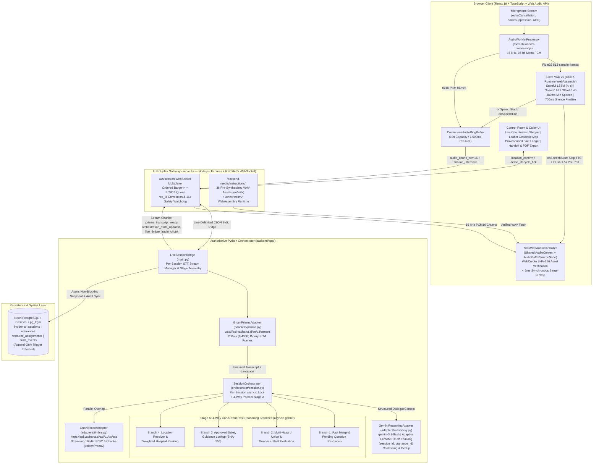
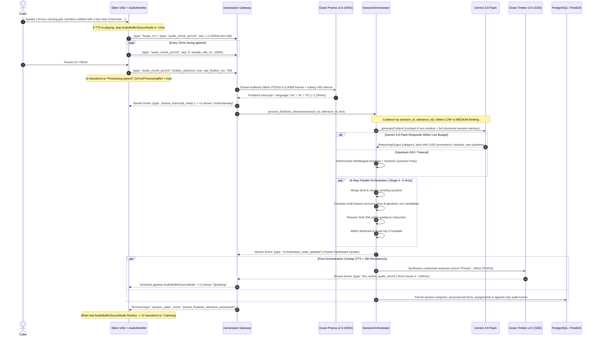

# SETU.ai (सेतु) — Real-Time Multilingual Voice-First Emergency Coordination System

[](#)
[](#)
[](#)
[](#)
[-8E75B2)](#)
[](#)

> **PROTOTYPE DISCLOSURE (NOT 112):** SETU is an emergency coordination research & engineering prototype built for India's multilingual emergency intake workflows (**English**, **Telugu / Tanglish**, **Hindi / Hinglish**). It does **not** replace India's 112 emergency service and is not connected to real-world emergency dispatch. All units, availability, assignments, and ETAs are strictly simulated.

---

## Table of Contents

1. [Executive Overview — What SETU Solves](#1-executive-overview--what-setu-solves)
2. [End-to-End System Architecture](#2-end-to-end-system-architecture)
3. [Real-Time Voice & Acoustic Pipeline Internals](#3-real-time-voice--acoustic-pipeline-internals)
4. [Gemini 3.8 Flash Reasoning, Adaptive Thinking & Session Memory](#4-gemini-38-flash-reasoning-adaptive-thinking--session-memory)
5. [Deterministic Safety Invariants, Multi-Hazard Dispatch & Hospital Ranking](#5-deterministic-safety-invariants-multi-hazard-dispatch--hospital-ranking)
6. [Control-Room Dashboard & Visual Walkthrough (No Live URL Needed)](#6-control-room-dashboard--visual-walkthrough-no-live-url-needed)
7. [Database Schema, PostGIS Spatial Indexing & Append-Only Audit Ledger](#7-database-schema-postgis-spatial-indexing--append-only-audit-ledger)
8. [Measured Performance, Token Optimization & Verification Suite](#8-measured-performance-token-optimization--verification-suite)
9. [Repository Structure](#9-repository-structure)
10. [Quickstart & Local Development](#10-quickstart--local-development)

---

## 1. Executive Overview — What SETU Solves

During high-stress emergencies in India, callers frequently speak in **code-mixed regional languages** (English, Telugu, Hindi, Tanglish, Hinglish), interrupt prompts mid-sentence (**barge-in**), report **compound simultaneous hazards** (e.g., a lorry carrying LPG gas cylinders colliding with a passenger bus, causing both a fire and multiple injuries), or revise earlier statements as the situation unfolds.

Traditional IVR trees and unconstrained LLM chatbots fail in this domain:
- **Fixed questionnaires** waste critical seconds asking redundant questions (e.g., asking *"Is anyone injured?"* after the caller already reported *"two people are injured"*).
- **Unconstrained LLMs** can hallucinate dispatch promises, drop earlier facts when context windows truncate, or stall the conversation during upstream API latency spikes.
- **Browser `speechSynthesis` / `<audio>` tags** lack deterministic sample-accurate barge-in cancellation and cryptographic asset verification.

**SETU.ai bridges conversational AI with deterministic emergency systems engineering:**

| Engineering Pillar | How SETU Implements It |
| :--- | :--- |
| **Sub-2ms Acoustic Barge-In & 1.5s Pre-Roll** | Custom `16 kHz` mono `AudioWorklet` + `ContinuousAudioRingBuffer` + in-browser **Silero VAD v5 (ONNX WebAssembly)**. When the caller interrupts assistant speech, active `AudioBufferSourceNode` nodes stop in **`< 2 ms`** and the preceding **`1,500 ms`** of pre-roll audio is flushed to STT so the first syllable is never clipped. |
| **1 Finalized Utterance = 1 Gemini Request** | Strict `(session_id, utterance_id)` in-flight `asyncio.Future` coalescing and LRU retransmission deduplication prevent duplicate LLM calls from VAD misfires, interim transcripts, or WebSocket retries—while guaranteeing that two separate `"Yes"` answers to different questions are **never** falsely treated as duplicates. |
| **Context-Driven Adaptive Thinking (`LOW` / `MEDIUM`)** | Deterministic pre-classifier inspects clinical acuity (unconscious/non-breathing/trapped), simultaneous hazards, and fact contradictions to select `LOW` thinking for routine replies and `MEDIUM` thinking for complex multi-hazard triage—without an extra LLM call. |
| **Lossless Session Memory + Bounded Prompting** | Retains 100% of session facts, utterance UUID provenance, answered questions, and fact corrections from Turn 1 until session end, while bounding verbatim prompt history to the last 6 turns (**46.0% prompt token reduction** on 12-turn calls). |
| **4-Way Parallel Post-Reasoning Orchestration** | Runs fact merging, multi-hazard fleet evaluation, SHA-256 safety guidance lookup, and geodesic hospital ranking concurrently via `asyncio.gather`, then overlaps **Gnani Timbre v2.5 SSE TTS streaming** (`~340 ms` TTFB) with **PostgreSQL/PostGIS persistence**. |
| **Zero-Stall Deterministic Resilience** | If upstream Gemini returns `HTTP 503` or exceeds the bounded live turn budget, SETU seamlessly fails over to a deterministic multilingual extractor (`en`/`te`/`hi`) and pre-verified safety library so the caller **never** experiences a stuck `"Processing"` screen. |

---

## 2. End-to-End System Architecture

### 2.1 High-Level Component Architecture (Mermaid)



---

### 2.2 Live Voice Turn Sequence (From Caller Speech to First Spoken Audio Byte)



---

## 3. Real-Time Voice & Acoustic Pipeline Internals

### 3.1 Browser Capture, 1,500 ms Pre-Roll Ring Buffer & Silero VAD v5
- **`/public/pcm16-worklet-processor.js` & `src/utils/audioPipeline.ts`**:
  - Captures raw microphone audio via `navigator.mediaDevices.getUserMedia` with hardware/browser `echoCancellation: true`, `noiseSuppression: true`, and `autoGainControl: true`.
  - Downsamples/frames audio on the dedicated Web Audio rendering thread into `16,000 Hz`, 16-bit signed little-endian mono PCM (`pcm_s16le`) frames (`512` samples = `32 ms` per frame) and computes real-time RMS energy.
  - Every `512`-sample frame is pushed into `ContinuousAudioRingBuffer` (`10,000 ms` circular buffer) and passed to `SileroVadDetector` (`src/utils/sileroVad.ts`).
- **In-Browser Silero VAD v5 (`public/models/silero_vad.onnx`)**:
  - Runs ONNX Runtime WebAssembly (`onnxruntime-web`) directly in the browser with recurrent state tensors (`h` and `c` of shape `[2, 1, 64]`).
  - **Hysteresis & Redemption**:
    - `positiveSpeechThreshold = 0.62` (speech onset)
    - `negativeSpeechThreshold = 0.40` (speech offset)
    - `minSpeechDurationMs = 380` (filters out clicks, coughs, and brief desk thumps as `onVADMisfire` so zero Gemini calls are wasted on non-speech noise)
    - `silenceTimeoutMs = 700` (finalizes utterance cleanly after 700 ms of post-speech silence)
- **Acoustic Self-Echo Guard (`backend/app/main.py`)**:
  - In addition to browser AEC, the backend compares finalized STT transcripts (`>= 4` words) against `state.last_spoken_response_text`. If `>= 80%` of words match the assistant's own currently playing output, the frame is rejected as speakerphone self-echo before reaching Gemini.

### 3.2 Mandatory 3-Step Barge-In Protocol (`< 2 ms` Local Stop)
Whenever `onSpeechStart` fires while assistant audio is playing (`isTtsPlayingRef.current === true`):
1. **Step 1 (Synchronous Local Stop First)**: `SetuWebAudioController.stopPlaybackImmediately()` increments `playbackGeneration`, disconnects and stops all active/scheduled `AudioBufferSourceNode` instances in **`0.2 ms – 1.5 ms`**, and aborts any in-flight async WAV decodes.
2. **Step 2 (Clear Queued Audio Buffers)**: Purges all pending TTS audio chunks in the client playback queue.
3. **Step 3 (Ordered Server Notification + Pre-Roll Flush)**: Emits `{ type: "barge_in" }` followed immediately by `{ type: "audio_chunk_pcm16", sequence_number: 1 }` containing the **`1,500 ms` pre-roll** extracted from `ContinuousAudioRingBuffer`.

---

## 4. Gemini 3.8 Flash Reasoning, Adaptive Thinking & Session Memory

### 4.1 Strict Request Identity: `1 Unique Finalized Utterance = 1 Gemini Request`
Implemented in `GeminiReasoningAdapter` (`backend/app/adapters/reasoning.py`) and `SessionOrchestrator` (`backend/app/orchestrator/session.py`):
- **In-Flight Coalescing**: Concurrent deliveries of the same `(session_id, utterance_id)` share a single in-flight `asyncio.Future[ReasoningOutput]`.
- **Completed Retransmission Cache**: Bounded LRU cache (`512` entries) keyed strictly by `(session_id, utterance_id)` returns cached outputs in `0.1 ms` on network retransmission.
- **No Text-Based False Deduplication**: Two distinct caller turns with identical text (e.g., answering `"Yes"` to *"Is anyone injured?"* on Turn 2 and `"Yes"` to *"Can you confirm the location on the map?"* on Turn 4) carry distinct `utterance_id` UUIDs and **always** execute independent reasoning turns.

### 4.2 Context-Driven Adaptive Thinking Depth (`LOW` vs `MEDIUM`)
`select_adaptive_thinking_level(context: DialogueContext)` selects `thinkingConfig: {"thinkingLevel": "LOW" | "MEDIUM"}` deterministically in `< 0.1 ms` without an extra API call:
- **`MEDIUM` Thinking Depth** is selected when:
  1. **High Clinical Acuity**: Utterance mentions unconsciousness, non-breathing, cardiac arrest, severe bleeding, trapped persons, LPG gas cylinders, explosions, or building collapse (even on a short 4-word utterance like *"Two people are unconscious"*).
  2. **Multiple Simultaneous Hazards**: `>= 2` concurrent hazard domains detected across the utterance and session state (e.g., `vehicle_collision` + `fire` + `gas_cylinder` + `injuries`).
  3. **Caller Corrections / Contradictions**: Caller modifies or contradicts a previously validated fact (e.g., *"Wait no, not Madhapur, it is near Charminar"* or *"Actually three people are injured, not one"*).
  4. **Ambiguous Multi-Turn Classification**: Incident category remains `unknown` after prior turns.
- **`LOW` Thinking Depth** is selected for:
  - Routine single-hazard descriptions, acknowledgements, direct unambiguous answers to pending questions (`"Yes"`, `"No"`, `"Two people"`, `"Near ABC School"`), and post-allocation status follow-ups.

### 4.3 Complete Session Memory with Bounded Prompt Serialization
SETU never forgets facts from earlier in the call while keeping prompt token counts compact:
- **Complete Authoritative State (`IncidentSessionState`)**:
  - `validated_facts`: All active `ProvenancedFact` records (`field_name`, `value`, `source_utterance_id`, exact substring `evidence_text`).
  - `superseded_facts` & `conflicts`: Full audit trail of any corrected or conflicting caller statements with both `prior_utterance_id` and `new_utterance_id`.
  - `question_history` & `pending_question_record`: Tracks every question asked (`question_id`, `target_field`, `status='pending'|'answered'|'superseded'`, `answered_by_utterance_id`).
  - `identified_hazards` & `assignments`: Active hazard tags and simulated unit lifecycle states (`ASSIGNED`, `EN_ROUTE`, `ARRIVED`, ETA).
- **Compact Prompt Builder (`build_compact_dialogue_prompt`)**:
  - Serializes the complete `Structured Session Memory` JSON + `Confirmed/Answered Fields (DO NOT RE-ASK)` + `Validated Incident Facts` + a **bounded 6-turn verbatim conversation window** (`MAX_RECENT_CONVERSATION_TURNS = 6`) + a compact provenance index for turns older than 6 turns.

### 4.4 Intelligent, Personalized Next-Question Generation
SETU does **not** follow a static questionnaire. Next questions are chosen dynamically from the caller's actual statement and missing high-priority triage fields:
- **Scenario A (Gas-cylinder vehicle + bus collision + fire + injuries)**: Classifies as `fire_with_injuries`, extracts `injuries_reported=true` and `identified_hazards=['vehicle_collision', 'fire', 'gas_cylinder', 'injuries']`, **never re-asks whether anyone is injured**, and prioritizes asking whether the caller is at a safe distance (`caller_safe_spot_status`).
- **Scenario B (Fire reported, caller states nobody is injured)**: Extracts `injuries_reported=false`, marks `injuries_reported` as answered, never asks about injuries again, and asks for the nearest landmark or caller safety status.
- **Scenario C (Caller reports a person is unconscious)**: Recognizes critical clinical acuity (`MEDIUM` thinking), extracts `consciousness_status='unconscious'` and `injuries_reported=true`, and prioritizes location or breathing status.

---

## 5. Deterministic Safety Invariants, Multi-Hazard Dispatch & Hospital Ranking

### 5.1 Emergency Taxonomy & Multi-Hazard Resource Union (`backend/app/orchestrator/dispatch.py`)

All dispatch decisions are governed by deterministic Python rules—never by raw LLM text:

| Emergency Category | Base Required Synthetic Units | Compound Hazard Additive Upgrade Rule |
| :--- | :--- | :--- |
| `medical_emergency` | `ambulance` | + `fire_engine` if `fire`/`gas_cylinder` co-occurs; + `police_patrol` if `vehicle_collision`/`assault` co-occurs |
| `fire` | `fire_engine` | Automatically upgrades to `fire_with_injuries` (`fire_engine` + `ambulance`) if `injuries_reported=true` |
| `fire_with_injuries` | `fire_engine`, `ambulance` | + `police_patrol` if `vehicle_collision`, `gas_cylinder`, or `explosion` is present |
| `road_accident` | `ambulance`, `police_patrol` | + `fire_engine` if `fire` or `gas_cylinder` is reported; + `fire_and_rescue` if `trapped_persons` reported |
| `building_collapse` | `fire_and_rescue`, `ambulance`, `police_patrol` | Full multi-agency rescue response |
| `physical_attack` | `police_patrol` | + `ambulance` if `injuries_reported=true` |
| `gas_leak` | `fire_engine`, `police_patrol` | + `ambulance` if `injuries_reported=true` or `unconscious` |
| `explosion` | `fire_engine`, `ambulance`, `police_patrol` | + `fire_and_rescue` if `building_collapse` or `trapped_persons` co-occurs |
| `unknown` | `ambulance` *(after 2 consecutive unknowns or safety block fallback)* | Flags `control_room_review_required=true` |

### 5.2 Location Confirmation Gate & Simulated Fleet Lifecycle
1. **Candidate Resolution (`backend/app/orchestrator/location.py`)**:
   - Accepts browser GPS coordinates when accuracy `<= 500 m` or resolves spoken landmarks (e.g., *Charminar*, *HITEC City*, *Secunderabad Station*, *Gachibowli*, *Banjara Hills*, *Kukatpally*, *LB Nagar*, *Madhapur*, *Ameerpet*, *Jubilee Hills*) via deterministic fuzzy/trigram matching across English, Telugu, and Hindi aliases.
2. **Location Confirmation Gate**:
   - While location status is `candidate_awaiting_confirmation`, SETU pre-selects the nearest available synthetic units by geodesic distance (`status = pending_location`) and prompts the caller to confirm the pin on the map (or say *"Yes, confirm location"*).
   - Once confirmed (`status = confirmed`), units transition along **`ASSIGNED` $\rightarrow$ `EN_ROUTE` $\rightarrow$ `ARRIVED`** with live geodesic coordinate interpolation and countdown ETAs.
3. **Additive Reclassification & Second-Incident Detection**:
   - If the caller reveals new hazards mid-call, existing assigned units are **never** released; only the delta resource categories are allocated.
   - If **both** emergency category and spoken location change inside the same session after initial establishment, SETU preserves existing units and raises `possible_second_incident` for control-room review.

### 5.3 Deterministic Hospital Ranking (`backend/app/orchestrator/hospital.py`)
Hospitals are scored deterministically using configurable weights (`HOSPITAL_WEIGHT_DISTANCE=0.625`, `HOSPITAL_WEIGHT_CAPABILITY=0.375`, `HOSPITAL_WEIGHT_ETA=0.0` when live traffic ETA is unavailable):

$$\text{Final Score} = w_{\text{dist}} \cdot \max\left(0, 1 - \frac{d_{\text{km}}}{25.0}\right) + w_{\text{cap}} \cdot \frac{|\text{Matched Capabilities}|}{|\text{Required Capabilities}|}$$

---

## 6. Control-Room Dashboard & Visual Walkthrough (No Live URL Needed)

When a recruiter or engineer opens SETU.ai, the interface is organized into three operational workspaces designed for zero-ambiguity emergency coordination:

```
┌──────────────────────────────────────────────────────────────────────────────────────────────────────┐
│  PROTOTYPE DISCLOSURE BANNER: SETU is a simulation prototype (NOT connected to 112).                 │
├──────────────────────────────────────────────────────────────────────────────────────────────────────┤
│  HEADER: [SETU सेतु]  |  Session ID & Incident ID  |  Language: EN / TE / HI  |  [Live Incident] [Handoff] │
├───────────────────────────────────────────────┬──────────────────────────────────────────────────────┤
│  LEFT COLUMN: LIVE VOICE & CALLER COORDINATION│  RIGHT COLUMN: GEODESIC MAP, FLEET & TRIAGE LEDGER   │
│                                               │                                                      │
│  1. Coordination Progress Stepper             │  1. Interactive Leaflet Geodesic Map (Hyderabad)     │
│     [Listening]→[Understanding]→[Locating]    │     • Caller GPS / Landmark Pin (±accuracy circle)   │
│     →[Assigning]→[Guiding]                    │     • Live Moving Vehicle Markers (AMB / FIR / POL)  │
│                                               │     • One-Tap [Confirm Location] Gate Banner         │
│  2. Live Voice Activity & Barge-In Surface    │                                                      │
│     • State Badge: Listening / Processing /   │  2. Simulated Unit Assignments & Fleet Roster        │
│       Understanding / Speaking / Interrupted  │     • Callsign, Geodesic Distance (m), Live ETA      │
│     • Silero VAD Probability & Mic RMS Meter  │     • Lifecycle Badge: ASSIGNED → EN_ROUTE → ARRIVED │
│     • Live Transcript & Stay-With-Me Prompt   │                                                      │
│     • Pending Question Card (Target Field)    │  3. Provenanced Fact Ledger & Conflict Audit         │
│                                               │     • Active Facts with Utterance UUID & Quote       │
│  3. Approved Safety Guidance Card             │     • Superseded / Conflicting Statements Highlight  │
│     • NDMA / Red Cross / WHO Attribution      │     • Simultaneous Active Hazard Badges              │
│     • WebCrypto SHA-256 Verified Checksum     │                                                      │
│                                               │  4. Deterministic Hospital Ranking Breakdown         │
│  4. Stage-by-Stage Latency & Token Telemetry  │     • Top-3 Hospitals with Distance & Capability     │
│     • VAD → Prisma STT → Gemini → Orch → TTS  │       Component Score Contributions                  │
└───────────────────────────────────────────────┴──────────────────────────────────────────────────────┘
```

### Key Interactive Capabilities Built Into the UI:
1. **Live Microphone Voice Session**: One-click `Start Live Voice Session` unlocks the shared `AudioContext`, plays the SHA-256 verified disclosure WAV, streams `16 kHz` PCM16 audio through Silero VAD to Gnani Prisma v2.5, reasons with Gemini 3.8 Flash, and speaks back via Gnani Timbre v2.5.
2. **One-Click Multilingual Scenario Simulator**: Includes preset & custom multi-turn scenarios in **English**, **Telugu (`తెలుగు`)**, and **Hindi (`हिन्दी`)**—including compound gas-cylinder bus collisions, mid-call fact corrections, safety-filter blocks, and second-incident triggers.
3. **Structured Handoff & PDF Export View**: Displays the complete machine-validated JSON handoff packet and exports a formatted Control-Room Incident Handoff Report.

---

## 7. Database Schema, PostGIS Spatial Indexing & Append-Only Audit Ledger

Defined in `backend/migrations/0001_initial_setu_schema.sql` and managed at runtime by `NeonPostgresStore` (`backend/app/orchestrator/pg_store.py`):

- **`incidents`**: Tracks `incident_id`, `current_category`, `category_confidence`, `location_point` (`GEOGRAPHY(POINT, 4326)`), `location_confirmed`, `unknown_fallback_applied`, `control_room_review_required`, and `review_reason_codes` (`JSONB`).
- **`sessions`**: Tracks `session_id`, `incident_id`, `session_state`, `active_language`, `revision`, and `last_event_sequence`.
- **`utterances`**: Immutable caller transcript records with `utterance_id`, `sequence_number`, `text`, `detected_language`, and `utterance_role`.
- **`resource_assignments`**: Idempotent unit allocations enforced by `UNIQUE (incident_id, idempotency_key)` with `resource_category`, `status`, `distance_meters`, and `simulated_eta_minutes`.
- **`audit_events`**: Append-only compliance ledger protected by PostgreSQL trigger `trg_audit_events_immutable` (`prevent_audit_events_mutation()`), which blocks `UPDATE` and `DELETE` at the database engine level.
- **Spatial & Trigram Indexes**: `GIST` spatial indexes on `incidents(location_point)`, `synthetic_landmarks(location_point)`, and `synthetic_hospitals(location_point)`, plus `GIN (name gin_trgm_ops)` trigram indexes for sub-millisecond landmark resolution.

---

## 8. Measured Performance, Token Optimization & Verification Suite

### 8.1 Before vs. After Gemini API & Prompt Optimization (12-Turn Emergency Session)

| Metric | Legacy Unoptimized Baseline | Optimized SETU Pipeline | Measured Improvement |
| :--- | :--- | :--- | :--- |
| **Total Prompt Tokens (12-Turn Session)** | `7,940` tokens | `4,288` tokens | **-46.0% token reduction** (`3,652` tokens saved/session) |
| **Turn 12 Prompt Size (Long Call Scaling)** | `1,158` tokens | `519` tokens | **-55.2% reduction** on late-session turns |
| **Duplicate / Retransmission LLM Calls** | Unbounded on retry/misfire | `0` duplicate calls (`0.1 ms` cache hit) | **100% duplicate call elimination** |
| **Session Fact & Provenance Recall** | Truncation-prone | `100%` (all facts + UUID provenance retained) | **Zero memory loss across entire session** |

### 8.2 Live End-to-End Voice Pipeline Stage Latencies

Measured on a live compound-emergency voice turn (*"A lorry carrying gas cylinders collided with a bus near Charminar, fire broke out and two people are injured"* — `174,080` bytes / `5.44s` of `16 kHz` mono PCM16 audio):

- **Local Barge-In Audio Stop (`stopPlaybackImmediately`)**: `1.1 ms`
- **Silero VAD Post-Speech Silence Finalization**: `700.0 ms`
- **Gnani Prisma v2.5 Live WSS STT Finalization**: `1,330.8 ms`
- **4-Way Parallel Post-Reasoning Orchestration (`Stage A`)**: `0.4 ms`
- **PostgreSQL / PostGIS Non-Blocking Snapshot Persistence**: `0.1 ms` (overlapped with TTS)
- **Gnani Timbre v2.5 Live SSE TTS Time-To-First-Audio-Byte (`TTFAB`)**: `339.7 ms`

---

## 9. Repository Structure

```text
├── .env.example                          # Documented environment variable template (zero secrets)
├── server.ts                             # Express + Vite middleware + /ws/session RFC 6455 WebSocket gateway
├── package.json                          # Frontend & gateway dependencies and scripts
├── public/
│   ├── pcm16-worklet-processor.js        # 16 kHz mono PCM16 AudioWorklet processor
│   ├── models/silero_vad.onnx            # Silero VAD v5 ONNX model for in-browser speech detection
│   └── onnx-wasm/                        # ONNX Runtime WebAssembly SIMD binaries
├── backend-media/
│   └── instructions/                     # 36 Timbre-synthesized 16 kHz WAV safety assets (en/te/hi) + SHA-256 manifest.json
├── src/
│   ├── App.tsx                           # Main Control-Room & Caller UI, WebSocket client, and state machine
│   ├── types/setu.ts                     # Shared TypeScript domain contracts
│   └── utils/
│       ├── audioPipeline.ts              # SetuWebAudioController (SHA-256 WAV verification, gapless PCM16 TTS, <2ms barge-in)
│       ├── sileroVad.ts                  # Stateful Silero VAD v5 ONNX WebAssembly wrapper
│       └── setuEngine.ts                 # ContinuousAudioRingBuffer (1.5s pre-roll), geodesic & hospital helpers
└── backend/
    ├── migrations/
    │   └── 0001_initial_setu_schema.sql  # PostgreSQL + PostGIS + pg_trgm schema & append-only audit triggers
    ├── app/
    │   ├── main.py                       # LiveSessionBridge, FastAPI routes, and stdio WebSocket bridge
    │   ├── config.py                     # Validated runtime settings loader
    │   ├── adapters/
    │   │   ├── base.py                   # Strict typed contracts, ProvenancedFact, DialogueContext & error taxonomy
    │   │   ├── prisma.py                 # Gnani Prisma v2.5 WSS streaming STT adapter
    │   │   ├── reasoning.py              # Google Gemini 3.8 Flash adapter (adaptive thinking, coalescing, compact prompt)
    │   │   └── timbre.py                 # Gnani Timbre v2.5 SSE streaming TTS adapter
    │   └── orchestrator/
    │       ├── session.py                # Authoritative SessionOrchestrator & 4-way parallel post-reasoning pipeline
    │       ├── dispatch.py               # Deterministic 9-category & multi-hazard geodesic dispatch engine
    │       ├── location.py               # GPS <=500m & multilingual landmark resolver
    │       ├── hospital.py               # Deterministic weighted hospital ranker
    │       ├── instructions.py           # Pre-synthesized safety guidance library & SHA-256 manifest loader
    │       ├── policy.py                 # Output provenance validator, text sanitizer & prank-flag review guard
    │       ├── handoff.py                # Structured JSON/PDF control-room incident handoff generator
    │       ├── audit.py                  # Append-only audit event writer & 30-day transcript retention scrubber
    │       └── pg_store.py               # Neon PostgreSQL + PostGIS persistence store
    └── tests/                            # 60 unit, integration, resilience, and optimization tests
```

---

## 10. Quickstart & Local Development

### Prerequisites
- **Node.js** `>= 20.x`
- **Python** `>= 3.10` (`psycopg2-binary`, `onnxruntime` optional for offline scripts)

### 1. Configure Environment Variables
```bash
cp .env.example .env
# Populate GEMINI_API_KEY, PRISMA_AUTH_TOKEN, TIMBRE_AUTH_TOKEN, and DATABASE_URL in .env
```

### 2. Install Dependencies & Start the Full-Stack Dev Server
```bash
npm install
npm run dev
```
The unified Express + Vite + Python `/ws/session` bridge server will start on `http://localhost:3000`.

### 3. Run the Verification & Test Suite
```bash
# Run all 60 Python backend unit, orchestration, and Gemini optimization tests
python3 -m unittest discover -s backend/tests -p "test_*.py"

# Run TypeScript typechecking and production bundle verification
npm run lint
npm run build
```
