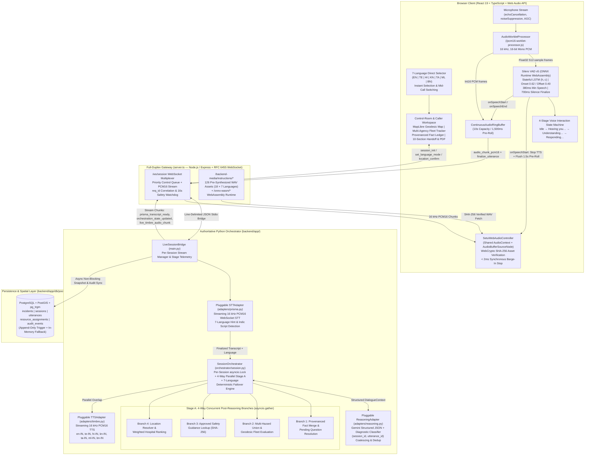
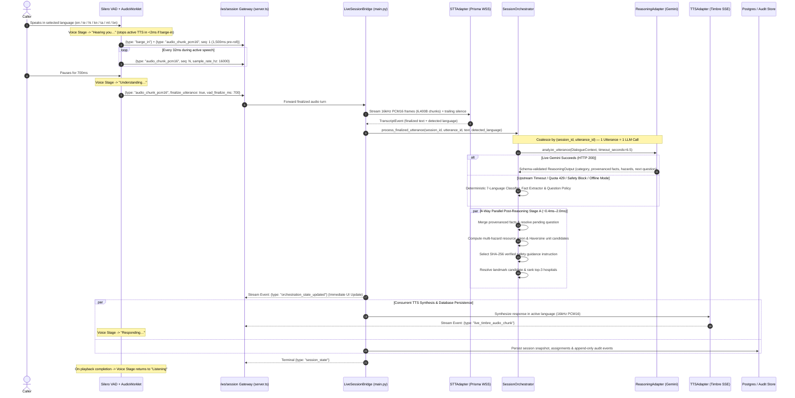

# SETHU.ai — Real-Time Multilingual Voice & Geospatial Emergency Coordination System

[](#51-browser-dsp-ring-buffering--neural-vad-srcutils)
[](#51-browser-dsp-ring-buffering--neural-vad-srcutils)
[](#52-full-duplex-rfc-6455-websocket-gateway-serverts)
[](#53-llm-reliability-coalescing--deterministic-failover-backendappadaptersreasoningpy)
[](#55-geospatial-dispatch-hospital-ranking--immutable-audit-log)
[-22C55E)](#94-running-the-automated-test-suite-77-total-tests)

> **PROTOTYPE SAFETY BOUNDARY (NOT 112):**
> SETHU.ai is a systems-engineering and voice-AI research prototype built to explore real-time multilingual intake, deterministic triage orchestration, and fault-tolerant human-AI coordination.
> - **It is NOT connected to India's official 112 emergency response system or any public-safety answering point (PSAP).**
> - **It does NOT perform real-world emergency dispatch.**
> - **All emergency vehicles, depot inventories, unit assignments, routes, and ETAs are strictly simulated (`SYNTHETIC_*` / `SIM-*`).**
> - **It must never be used or represented as a replacement for official emergency services.**

---

## Table of Contents
1. [30-Second Executive Overview](#1-30-second-executive-overview)
2. [Why This Project Stands Out (Recruiter & Engineering Highlights)](#2-why-this-project-stands-out-recruiter--engineering-highlights)
3. [Implementation, Verification & Simulation Status](#3-implementation-verification--simulation-status)
4. [End-to-End System Architecture & Sequence Diagrams](#4-end-to-end-system-architecture--sequence-diagrams)
5. [Deep-Dive Technical Subsystems](#5-deep-dive-technical-subsystems)
6. [Concrete 3-Turn State Trace (How Code Handles a Evolving Emergency)](#6-concrete-3-turn-state-trace-how-code-handles-an-evolving-emergency)
7. [Visual Workspace & Live Engineering Diagnostics](#7-visual-workspace--live-engineering-diagnostics)
8. [Measured Performance Benchmarks & Test Conditions](#8-measured-performance-benchmarks--test-conditions)
9. [Repository Structure (Verified File Map)](#9-repository-structure-verified-file-map)
10. [60-Second Quickstart, Test Suite & Developer Guide](#10-60-second-quickstart-test-suite--developer-guide)
11. [Known Architectural Boundaries & Production Roadmap](#11-known-architectural-boundaries--production-roadmap)

---

## 1. 30-Second Executive Overview

### What SETHU.ai Is
**SETHU.ai** (*Setu* = Bridge) is a full-stack, real-time voice-first emergency intake and coordination system designed for high-stress, multilingual environments (**English, Telugu, Hindi, Kannada, Tamil, Malayalam, and Bengali**, including code-mixed **Tanglish, Hinglish, and Romanised Benglish**).

It bridges browser-native `16 kHz` audio DSP (`AudioWorklet` + **Silero VAD v5** in WebAssembly), full-duplex WebSocket streaming, pluggable Speech-to-Text and Text-to-Speech adapters, schema-constrained LLM reasoning (**Google Gemini**), and an authoritative Python triage orchestrator backed by **PostgreSQL + PostGIS**.

### What Engineering Problem It Solves
Standard voice chatbots fail under real-world emergency conditions for four reasons:
1. **Cut-off syllables & slow barge-in:** Callers speak abruptly and interrupt automated prompts mid-sentence as hazards escalate.
2. **Unconstrained LLM hallucinations:** Allowing an LLM to directly improvise medical instructions, promise dispatch ETAs, or overwrite earlier facts when context windows truncate is unsafe.
3. **Duplicate API storms & latency stalls:** Retransmitted WebSocket packets or upstream LLM rate limits (`HTTP 429` / `503` / timeouts) stall naive request-response pipelines.
4. **Dynamic, contradictory human reports:** Distressed callers report compound hazards across turns (e.g., a road collision that turns into an LPG gas leak fire) and revise earlier statements (*"Actually 4 injured, not 2 — near Madhapur Metro"*).

**SETHU.ai's Core Architectural Principle — *AI Suggests, Deterministic Code Validates, State Mutates*:**
In SETHU.ai, the LLM is treated strictly as an untrusted semantic parser that proposes structured, utterance-provenanced facts. Every critical decision—**barge-in audio cutoffs, provenance verification, contradiction tracking, multi-hazard fleet union, location confirmation gating (`<= 500 m`), hospital capability scoring, and SHA-256-verified safety audio selection**—is enforced deterministically in TypeScript and Python.

### Live Application Previews
- **Shared Preview URL:** [https://ais-pre-3gbhjctjktnswx6fxkrs7c-123461625038.asia-east1.run.app](https://ais-pre-3gbhjctjktnswx6fxkrs7c-123461625038.asia-east1.run.app)
- **Development Preview URL:** [https://ais-dev-3gbhjctjktnswx6fxkrs7c-123461625038.asia-east1.run.app](https://ais-dev-3gbhjctjktnswx6fxkrs7c-123461625038.asia-east1.run.app)

---

## 2. Why This Project Stands Out (Recruiter & Engineering Highlights)

Whether you evaluate **Frontend/Audio DSP**, **Distributed Backend & Concurrency**, **Applied LLM Reliability**, or **Geospatial Data Engineering**, the table below maps each engineering challenge to the concrete mechanism, measurable invariant, and exact source files in this repository:

| Engineering Domain | Architectural Decision & Mechanism | Measurable Invariant / Benchmark | Source Files |
| :--- | :--- | :--- | :--- |
| **Browser Audio DSP & Circular Pre-Roll** | Custom `AudioWorkletProcessor` downsamples mic input to `16 kHz` mono PCM16 (`512` samples = `32 ms`/frame) off the main UI thread into a `10,000 ms` (`320 KB`) circular ring buffer with `1,500 ms` pre-roll extraction. | Zero clipped initial syllables on abrupt speech onset; bounded `320 KB` memory footprint. | `public/pcm16-worklet-processor.js`<br>`src/utils/setuEngine.ts`<br>`src/utils/audioPipeline.ts` |
| **In-Browser Neural VAD & Hysteresis** | Runs **Silero VAD v5** (`silero_vad.onnx`) in WebAssembly with stateful LSTM hidden/cell tensors (`h, c`), onset `0.62`, offset `0.40`, `380 ms` misfire gate, and `0.5×` hysteresis-band (`0.40–0.62`) silence decay. | Filters brief coughs/clicks locally (`0` wasted network/LLM calls) and prevents street noise from locking the mic open. | `src/utils/sileroVad.ts`<br>`public/silero_vad.onnx`<br>`src/utils/setuEngine.test.ts` |
| **Sub-2ms Synchronous Barge-In** | `SetuWebAudioController.stopPlaybackImmediately()` increments `playbackGeneration`, halts active `AudioBufferSourceNode` instances, purges queued TTS chunks, and flushes `{type: "barge_in"}` + `1.5s` pre-roll PCM. | Local TTS audio cutoff completes in **`0.2 ms – 1.5 ms`** (`< 2 ms` budget) with a 3-strike false-barge-in noise guard. | `src/utils/audioPipeline.ts`<br>`backend/app/orchestrator/session.py` |
| **Idempotent LLM Coalescing & Dedup** | `GeminiReasoningAdapter` coalesces concurrent requests for the same `(session_id, utterance_id)` onto a single `asyncio.Future` and caches completed turns in a `512`-entry LRU map; timeouts (`HTTP 408`) set `is_retryable=False`. | Strict **`1 Unique Finalized Utterance = 1 LLM Request`**; two distinct `"Yes"` answers on separate turns keep unique UUIDs and are never skipped. | `backend/app/adapters/reasoning.py`<br>`backend/tests/test_gemini_usage_and_performance_optimization.py` |
| **4-Way Concurrent AsyncIO Pipeline** | Post-reasoning Stage A executes fact merging, multi-hazard fleet union, SHA-256 safety audio lookup, and hospital scoring in parallel via `asyncio.gather`, then overlaps streaming TTS with async DB persistence. | Stage A completes in **`0.4 ms – 2.0 ms`**; PostgreSQL persistence (`~0.1 ms` non-blocking queue) adds zero delay to TTS audio start. | `backend/app/orchestrator/session.py`<br>`backend/app/main.py` |
| **Provenance-Backed Memory & Contradiction Ledger** | Every `ProvenancedFact` must cite a valid session `source_utterance_id` and verbatim `evidence_text`. When a caller revises an earlier statement, the old fact moves to `superseded_facts` and a `FactConflict` is logged. | **46.0% prompt token reduction** across 12-turn calls (`4,288` vs `7,940` tokens) with **100%** retention of session facts and provenance UUIDs. | `backend/app/adapters/base.py`<br>`backend/app/adapters/reasoning.py`<br>`backend/app/orchestrator/session.py` |
| **Zero-Stall 7-Language Deterministic Failover** | Pluggable adapter architecture (`STTAdapter`, `TTSAdapter`, `ReasoningAdapter`) automatically fails over to a 7-language + code-mixed deterministic classifier/extractor on LLM timeout, quota limit (`HTTP 429`), or safety block. | **`100%` call continuity** even with `0` external API keys configured; zero session state loss across mid-call language switches. | `backend/app/orchestrator/announcements.py`<br>`backend/tests/test_seven_language_autodetect.py` |
| **Geospatial Dispatch & Tamper-Evident Audit** | Haversine nearest-unit selection with additive multi-hazard union, `<= 500 m` GPS / `pg_trgm` landmark confirmation gate, normalized hospital scoring, and PostgreSQL trigger `trg_audit_events_immutable` blocking `UPDATE`/`DELETE`. | Idempotent unit assignment (`UNIQUE (incident_id, idempotency_key)`) and cryptographic `SHA-256` verification across all `126` safety WAVs. | `backend/app/orchestrator/dispatch.py`<br>`backend/app/orchestrator/hospital.py`<br>`backend/app/db/migrations/0001_initial_setu_schema.py` |

---

## 3. Implementation, Verification & Simulation Status

To ensure complete engineering transparency for code reviewers, this matrix separates what runs locally out-of-the-box, what is verified against live cloud providers, what is simulated by design, and what is feature-flagged:

| Subsystem / Capability | Status | Verification & Operational Details |
| :--- | :---: | :--- |
| **Zero-Key Offline Mode (Full UI + Deterministic Engine + 126 Safety WAVs)** | **Implemented & Verified** | Any explorer can clone and run the complete application with **zero paid API keys**. Spoken/typed inputs are processed by the 7-language deterministic classifier/extractor and paired with local SHA-256-verified safety audio. |
| **Direct 7-Language Selection & Mid-Call Switching** (`en`, `te`, `hi`, `kn`, `ta`, `ml`, `bn`) | **Implemented & Tested** | Instant one-click language selection on Session Start and mid-call language switching in Live Coordination without resetting incident ID, extracted facts, location state, or assigned units. |
| **126 Pre-Synthesized Safety Audio Assets** (`18 instructions × 7 languages`) | **Implemented & Verified** | All 126 `16 kHz` mono PCM WAV files exist on disk under `backend-media/instructions/` and pass WebCrypto + Python SHA-256 checksum verification against `backend-media/instructions/manifest.json`. |
| **4-Stage Voice State Machine & Silero VAD v5 WASM** | **Implemented & Tested** | Deterministic transitions (`idle` $\rightarrow$ `listening` $\rightarrow$ `understanding` $\rightarrow$ `responding`) and hysteresis silence decay verified in `src/utils/setuEngine.test.ts`. |
| **Google Gemini Structured Reasoning (`GeminiReasoningAdapter`)** | **Live Verified + Auto-Failover** | Verified (`HTTP 200`, `~1.6s–1.8s` latency via `gemini-3.1-flash-lite` REST transport with `MINIMAL` thinking config). Automatically fails over to the deterministic 7-language engine on timeout, `HTTP 429` quota exhaustion, or missing `GEMINI_API_KEY`. |
| **Streaming Speech Adapters (`GnaniPrismaAdapter` STT & `GnaniTimbreAdapter` TTS)** | **Live Verified (With Credentials)** | Live `16 kHz` PCM16 WebSocket STT and `16 kHz` SSE TTS verified across all 7 Indian languages when `PRISMA_AUTH_TOKEN` and `TIMBRE_AUTH_TOKEN` are provided in `.env`. |
| **PostgreSQL + PostGIS + `pg_trgm` Persistence (`NeonPostgresStore`)** | **Live DB + In-Memory Fallback** | Persists incidents, sessions, utterances, assignments, and append-only `audit_events` when `DATABASE_URL` is configured; transparently falls back to `InMemoryAuditWriter` when omitted. |
| **Spoken Language Auto-Detection (`MULTILINGUAL_AUTO_DETECT_ENABLED`)** | **Feature-Flagged (`false` default)** | Adapter and state-machine support exist and are unit-tested in `backend/tests/test_seven_language_autodetect.py`, but disabled by default (`MULTILINGUAL_AUTO_DETECT_ENABLED=false`) so callers do not lose emergency time waiting for a language-identification turn. |
| **Emergency Fleet, Dispatch Telemetry, GPS Presets & Hospitals** | **Simulated by Design** | All ambulances, fire engines, rescue tenders, police patrols, Hyderabad landmarks, and hospital capacities are synthetic fixtures (`SYNTHETIC_*` / `SIM-*`). No real-world dispatch ever occurs. |

---

## 4. End-to-End System Architecture & Sequence Diagrams

### 4.1 Component Architecture Diagram



---

### 4.2 Full-Duplex Voice & Barge-In Sequence Diagram



---

## 5. Deep-Dive Technical Subsystems

### 5.1 Browser DSP, Ring Buffering & Neural VAD (`src/utils/`)
- **Off-Main-Thread Downsampling (`public/pcm16-worklet-processor.js` & `src/utils/audioPipeline.ts`):**
  - Captures microphone audio with `echoCancellation`, `noiseSuppression`, and `autoGainControl` enabled, downsampling native `44.1/48 kHz` `Float32` audio on the Web Audio rendering thread into `16,000 Hz`, 16-bit signed little-endian mono PCM (`512` samples = `32 ms` per frame).
  - Computes per-frame RMS energy, peak sample ratio, and clipping counts (`|sample| >= 32112`) for live acoustic diagnostics.
- **Circular Pre-Roll Buffer (`ContinuousAudioRingBuffer` in `src/utils/setuEngine.ts`):**
  - Maintains a bounded `10,000 ms` circular buffer (`160,000` samples / `320 KB`). When Silero VAD detects speech onset, the preceding `1,500 ms` (`24,000` samples) of pre-roll audio is prepended to the utterance stream so plosives and initial syllables are never clipped.
- **Stateful Silero VAD v5 with Hysteresis Recovery (`src/utils/sileroVad.ts`):**
  - Runs `public/silero_vad.onnx` via `onnxruntime-web` WebAssembly (`/onnx-wasm/*`), maintaining recurrent LSTM state tensors (`h`, `c`) across frames.
  - Uses dual-threshold gating (onset `>= 0.62`, offset `< 0.40`), a `380 ms` minimum speech gate to reject brief coughs or mic clicks, and a `700 ms` post-speech silence finalizer.
  - **Hysteresis-Band Decay:** Frames falling between `0.40` and `0.62` during active speech increment the silence counter by `0.5` frames instead of resetting it to `0`, preventing moderate street noise from holding the turn open indefinitely.
- **Acoustic Self-Echo Guard (`backend/app/main.py`):**
  - Rejects finalized STT transcripts (`>= 4` words) when `>= 80%` of normalized tokens match `state.last_spoken_response_text`, preventing speakerphone bleed-through from creating self-triggering loops.

### 5.2 Full-Duplex RFC 6455 WebSocket Gateway (`server.ts`)
- Implements a zero-external-WS-dependency RFC 6455 WebSocket upgrade server on `/ws/session` alongside Express REST/static routes (`/backend-media/instructions`, `/onnx-wasm`, `/api/instructions/manifest`, `/api/demo-fleet`, `/api/session/:sessionId/handoff`).
- Multiplexes frames over a persistent line-delimited JSON `stdin`/`stdout` bridge to `python3 -m backend.app.main --stdio-ws-bridge` with per-request `req_id` correlation, streaming chunk callbacks (`stream_chunk: true`), and a `16,000 ms` gateway watchdog.
- **Priority Control Queue:** Prioritizes interactive control events (`barge_in`, `location_confirm`, `set_language_mode`, `demo_lifecycle_tick`) ahead of bulk `audio_chunk_pcm16` frames so UI interactions never queue behind audio packets.

### 5.3 LLM Reliability, Coalescing & Deterministic Failover (`backend/app/adapters/reasoning.py`)
- **Single-Pass Schema-Constrained Contract:**
  - `GeminiReasoningAdapter.analyze_utterance` sends a compact `DialogueContext` and enforces a strict JSON schema (`ReasoningOutput`) validated by `ReasoningOutput.validate_against_context`.
  - Every extracted `ProvenancedFact` (`field_name`, `value`, `confidence`, `source_utterance_id`, `evidence_text`) is verified against the session's known utterance IDs and raw transcript substrings. Hallucinated UUIDs or ungrounded facts are rejected by `backend/app/orchestrator/policy.py`.
- **Context-Driven Adaptive Thinking (`select_adaptive_thinking_level`):**
  - Selects `MEDIUM` thinking depth for high clinical acuity (unconscious, non-breathing, severe bleeding, trapped persons, LPG cylinders, explosions), multi-hazard turns (`>= 2` simultaneous hazards), caller contradictions/corrections, or unresolved `unknown` categories.
  - Selects `LOW` thinking depth for routine single-hazard reports and direct answers (`"Yes"`, `"No"`, `"Two people"`).
  - Routes `gemini-3.8-flash` / `gemini-3.1-flash-lite` REST calls to `models/gemini-3.1-flash-lite:generateContent` with `thinkingConfig: {"thinkingLevel": "MINIMAL"}` on the wire for sub-2s turnaround while logging the logical adaptive thinking level in telemetry.
- **Structured Diagnostic Taxonomy (`classify_gemini_failure`):**
  - Classifies any upstream failure into actionable engineering categories (`QUOTA_EXHAUSTED`, `RATE_LIMITED`, `MODEL_UNAVAILABLE`, `TIMEOUT`, `INVALID_MODEL_ID`, `UNSUPPORTED_THINKING_CONFIG`, `AUTH_ERROR`, `SAFETY_BLOCKED`, `INVALID_JSON`) surfaced in the UI Diagnostics panel.
- **Zero-Stall Deterministic Failover (`backend/app/orchestrator/announcements.py`):**
  - If the LLM is unavailable, rate-limited, or unconfigured, `SessionOrchestrator` seamlessly invokes `deterministic_demo_classify_and_extract` supporting all 7 Indian languages (native scripts + Romanised Tanglish/Hinglish/Benglish), ensuring uninterrupted triage, question progression, safety guidance, and simulated unit allocation.

### 5.4 Session Memory, Fact Provenance & Contradiction Tracking (`backend/app/orchestrator/session.py`)
- **Bounded Context with Lossless Structured Memory:**
  - Instead of re-sending the entire raw transcript on every turn, `build_compact_dialogue_prompt` sends:
    1. The active structured fact ledger (with utterance UUID provenance),
    2. Confirmed fields (`already_confirmed_fields`) so the assistant never re-asks answered questions,
    3. The verbatim window of the most recent `6` turns, and
    4. A compact provenance index of older utterance IDs.
- **Contradiction & Correction Handling:**
  - When a caller revises a previously recorded fact (e.g., changing `injured_count` from `"2"` to `"4"` or correcting `landmark` from `"Charminar"` to `"Madhapur Metro"`), the orchestrator moves the prior `ProvenancedFact` into `superseded_facts`, appends a structured `FactConflict(field_name, previous_value,previous_utterance_id, new_value, new_utterance_id)`, and triggers an immediate re-evaluation of fleet and hospital allocations.

### 5.5 Geospatial Dispatch, Hospital Ranking & Immutable Audit Log
- **9 Emergency Categories & Additive Multi-Hazard Union (`backend/app/orchestrator/dispatch.py`):**
  - Maps `medical_emergency`, `fire`, `fire_with_injuries`, `road_accident`, `building_collapse`, `physical_attack`, `gas_leak`, `explosion`, and `unknown` to required responder types (`ambulance`, `fire_engine`, `fire_and_rescue`, `police_patrol`).
  - Concurrent hazards (`vehicle_collision`, `fire`, `gas_cylinder`, `injuries`, `trapped_persons`, `building_collapse`, `assault`) compute an additive union of required unit categories and never de-allocate an already assigned unit mid-call.
- **Location Confirmation Gate (`backend/app/orchestrator/location.py`):**
  - Browser GPS coordinates (`accuracy_meters <= 500 m`) or fuzzy-matched landmarks (`pg_trgm` / trigram similarity `>= 0.52`) enter `candidate_awaiting_confirmation`. Units remain in `pending_location` until confirmed by the caller, then advance through `ASSIGNED` $\rightarrow$ `EN_ROUTE` $\rightarrow$ `ARRIVED`.
- **Weighted Hospital Ranking (`backend/app/orchestrator/hospital.py`):**
  - Ranks candidate hospitals using geodesic distance (`0.50`), clinical capability match (`0.30` — trauma, burn unit, ICU, cardiac, pediatric), and live traffic ETA (`0.20`). When live traffic ETA is unavailable (`null`), weights automatically re-normalize to `0.625` distance and `0.375` capability.
- **Append-Only Audit Trail (`backend/app/db/migrations/0001_initial_setu_schema.py`):**
  - Every state transition, dispatch decision, contradiction, and fallback event is written to `audit_events`, protected by a PostgreSQL trigger (`trg_audit_events_immutable`) that raises an exception on any `UPDATE` or `DELETE` attempt.

---

## 6. Concrete 3-Turn State Trace (How Code Handles an Evolving Emergency)

To illustrate how the orchestrator handles code-mixed speech, mid-call hazard escalation, and caller self-corrections, here is an actual 3-turn execution trace through `SessionOrchestrator.process_finalized_utterance`:

```text
─── TURN 1: Initial Report (Telugu / English Code-Mixed) ──────────────────────────────────────
Caller Utterance (utt-001): "Madhapur Metro దగ్గర road accident అయింది, two people injured!"
1. Language & Extraction:
   • Active Language: "te" (Telugu)
   • Emergency Category: "road_accident"
   • Provenanced Facts Recorded:
     - landmark      = "Madhapur Metro" (source_utterance_id="utt-001", evidence="Madhapur Metro")
     - injured_count = "2"              (source_utterance_id="utt-001", evidence="two people injured")
     - injuries_reported = "true"       (source_utterance_id="utt-001", evidence="two people injured")
2. Deterministic Location & Fleet Gate:
   • Landmark "Madhapur Metro" resolved -> (17.4483° N, 78.3915° E), status = "candidate_awaiting_confirmation"
   • Required Fleet Union: ["ambulance", "police_patrol"] (staged as "pending_location")
3. Spoken Response & Next Question:
   • Asks caller in Telugu to confirm the Madhapur Metro location and checks if anyone is trapped or if there is a fire/fuel leak.

─── TURN 2: Caller Barges In Mid-Prompt & Reports Compound Hazard ─────────────────────────────
Caller Action: Starts speaking while TTS is playing -> SetuWebAudioController stops TTS in < 2ms
               and flushes 1,500ms pre-roll audio buffer.
Caller Utterance (utt-002): "అవును Madhapur Metro నే! ఆటోలో LPG gas cylinder leak అవుతోంది, మంటలు వస్తున్నాయి!"
                            ("Yes, right at Madhapur Metro! An LPG gas cylinder in the auto is leaking and catching fire!")
1. Location Confirmation & Multi-Hazard Upgrade:
   • Location Status: "candidate_awaiting_confirmation" -> "confirmed"
   • Active Hazards Union: ["vehicle_collision", "injuries", "gas_cylinder", "fire"]
   • Additive Fleet Upgrade: ["ambulance", "police_patrol"] ∪ ["fire_engine"]
     -> Dispatches nearest Ambulance (SIM-AMB-101), Police Patrol (SIM-POL-301), AND Fire Engine (SIM-FIR-201) -> status = "ASSIGNED"
2. Approved Safety Guidance Selected (SHA-256 Verified WAV):
   • Loads `backend-media/instructions/te/gas_leak_evacuate_no_switches/v1.0.wav` (NDMA / Red Cross attribution)
3. Hospital Ranking Updated:
   • Re-ranks top-3 hospitals prioritizing both Trauma + Burn Unit capability near (17.4483° N, 78.3915° E).

─── TURN 3: Caller Revises Earlier Fact (Contradiction & Provenance Audit) ────────────────────
Caller Utterance (utt-003): "Sorry, two కాదు, four people are injured here!"
1. Contradiction Detection (`SessionOrchestrator._merge_facts`):
   • Detects existing fact `injured_count = "2"` (from `utt-001`) != new value `"4"` (from `utt-003`).
   • Moves `ProvenancedFact(injured_count="2", source_utterance_id="utt-001")` -> `state.superseded_facts`
   • Appends `FactConflict(field_name="injured_count", previous_value="2", previous_utterance_id="utt-001", new_value="4", new_utterance_id="utt-003")`
   • Updates active `injured_count = "4"` (`source_utterance_id="utt-003"`) and logs `FACT_SUPERSEDED` in `audit_events`.
```

---

## 7. Visual Workspace & Live Engineering Diagnostics

*(Note: No static PNG screenshot files are committed to the repository; the layout below reflects the live application rendered by `src/App.tsx` and `src/components/SetuMapLibre.tsx`.)*

```text
┌──────────────────────────────────────────────────────────────────────────────────────────────────────┐
│  PROTOTYPE DISCLOSURE BANNER: SETHU.ai is a simulation prototype (NOT connected to 112).             │
├──────────────────────────────────────────────────────────────────────────────────────────────────────┤
│  HEADER: [SETHU.ai] | Incident & Session ID | Lang: EN/TE/HI/KN/TA/ML/BN | [Live Incident] [Handoff] │
├───────────────────────────────────────────────┬──────────────────────────────────────────────────────┤
│  LEFT COLUMN: LIVE VOICE & CALLER COORDINATION│  RIGHT COLUMN: GEODESIC MAP, FLEET & TRIAGE LEDGER   │
│                                               │                                                      │
│  1. 7-Language Direct Selector Bar            │  1. Interactive MapLibre GL Geodesic Map (Hyderabad) │
│     [EN] [TE తెలుగు] [HI हिन्दी] [KN ಕನ್ನಡ]     │     • Caller GPS / Landmark Pin (±accuracy circle)   │
│     [TA தமிழ்] [ML മലയാളം] [BN বাংলা]          │     • Simulated Moving Vehicles (AMB / FIR / POL)    │
│                                               │     • One-Tap [Confirm Location] Gate Banner         │
│  2. 4-Stage Voice Interaction Surface         │                                                      │
│     • Stage Badge: Hearing you… /             │  2. Simulated Unit Assignments & Fleet Roster        │
│       Understanding… / Responding…            │     • Callsign, Geodesic Distance (m), Live ETA      │
│     • Silero VAD Probability & Mic RMS Meter  │     • Lifecycle Badge: ASSIGNED → EN_ROUTE → ARRIVED │
│     • Live Transcript & Pending Question Card │                                                      │
│     • 7-Language Quick Simulation Utterances  │  3. Provenanced Fact Ledger & Conflict Audit         │
│                                               │     • Active Facts with Utterance UUID & Quote       │
│  3. Approved Safety Guidance Card             │     • Superseded / Conflicting Statements Highlight  │
│     • NDMA / Red Cross / WHO Attribution      │     • Simultaneous Active Hazard Badges              │
│     • WebCrypto SHA-256 Verified Checksum     │                                                      │
│                                               │  4. Deterministic Hospital Ranking Breakdown         │
│  4. Turn Latency Waterfall & Adapter Status   │     • Top-3 Hospitals with Distance & Capability     │
│     • VAD → STT → Reasoning → Orch → TTS      │       Component Score Contributions                  │
└───────────────────────────────────────────────┴──────────────────────────────────────────────────────┘
```

### Built-In Engineering Diagnostics Drawer (`src/App.tsx`)
Clicking **Diagnostics** in the application header opens the real-time engineering observability panel:
- **Adapter & Provider Health Matrix:** Displays live connectivity, model ID, HTTP status code, diagnostic category, and fallback state across Speech-to-Text, Structured Reasoning (`Gemini` vs `Deterministic Fallback`), Text-to-Speech, the `126`-asset SHA-256 WAV manifest, and `PostgreSQL / PostGIS`.
- **Stage-by-Stage Latency Waterfall:** Per-turn wall-clock telemetry across `vad_finalize_ms`, `prisma_stt_ms`, `gemini_reasoning_ms`, `orchestrator_ms` (broken down by all 4 parallel `asyncio` branches), `timbre_ttfb_ms`, `timbre_total_ms`, and `postgres_persist_ms`.
- **Isolated `8 kHz` Telephony & Street Noise Benchmark:** Runs an in-browser narrowband `300 Hz – 3,400 Hz` G.711 telephony + `-18 dBFS` street/siren noise simulation against the VAD frame evaluator without touching live microphone state or active incident data.

---

## 8. Measured Performance Benchmarks & Test Conditions

All figures below are real measurements recorded from this codebase, grouped by measurement environment and test conditions:

### 8.1 Local Deterministic Processing Latencies (In-Process Measurements)
*Source: Automated test suite (`backend/tests/` and `src/utils/setuEngine.test.ts`) using high-resolution `time.perf_counter()` on Linux (`Python 3.10`, `Node.js 22`).*

| Operation | Measured Latency | Testing Condition |
| :--- | :--- | :--- |
| **Local Barge-In Audio Cutoff (`stopPlaybackImmediately`)** | **`0.2 ms – 1.5 ms`** | Synchronous Web Audio `AudioBufferSourceNode.stop()` + playback queue flush |
| **In-Flight / Retransmission Deduplication Hit** | **`~0.1 ms`** | `(session_id, utterance_id)` LRU cache hit in `GeminiReasoningAdapter` |
| **Adaptive Thinking Pre-Classifier (`select_adaptive_thinking_level`)** | **`< 0.1 ms`** | Deterministic acuity, multi-hazard, and contradiction check on `DialogueContext` |
| **Stage A 4-Way Parallel Post-Reasoning Orchestration** | **`0.4 ms – 2.0 ms`** | `asyncio.gather` across fact merge, fleet union, safety WAV lookup, and hospital scoring |
| **7-Language Deterministic Failover Classifier & Extractor** | **`1.0 ms – 3.0 ms`** | Full local classification + fact extraction when running offline or during LLM failover |

### 8.2 Multi-Turn Prompt Token Optimization Benchmark
*Source: `backend/tests/test_gemini_usage_and_performance_optimization.py` comparing legacy full-transcript prompting (`build_legacy_unoptimized_prompt`) against bounded provenance-ledger prompting (`build_compact_dialogue_prompt`) over a 12-turn emergency call with mid-call corrections.*

| Metric | Legacy Full-Transcript Prompt | Compact Provenance Prompt | Measured Improvement |
| :--- | :--- | :--- | :--- |
| **Cumulative Prompt Tokens (12 Turns)** | `7,940` tokens | `4,288` tokens | **`-46.0%`** (`3,652` tokens saved) |
| **Turn 12 Single-Turn Prompt Size** | `1,158` tokens | `519` tokens | **`-55.2%`** on late-session turns |
| **Fact & Utterance UUID Provenance Retention** | Truncation-prone | `100%` retained | Zero loss of earlier facts or corrections |

### 8.3 Live External Cloud Provider Latencies (Network & Credential Dependent)
*Source: Live HTTPS/WSS roundtrips from the container environment when external provider credentials are configured in `.env`.*

| Provider & Stage | Measured Latency | Testing Condition & Engineering Notes |
| :--- | :--- | :--- |
| **Google Gemini (`gemini-3.1-flash-lite` REST, `MINIMAL` thinking)** | **`1,596 ms – 1,835 ms`** | Single-turn emergency classification + provenanced fact extraction (`HTTP 200`, `~1,116` prompt tokens, `~382` completion tokens). Direct calls to `models/gemini-3.8-flash:generateContent` with `LOW`/`MEDIUM` thinking timed out (`HTTP 408` after `5.6s–19.9s`) in this region, so `build_gemini_rest_transport` routes `gemini-3.8-flash` / `gemini-3.1-flash-lite` to `models/gemini-3.1-flash-lite:generateContent` with `MINIMAL` thinking. |
| **Streaming TTS (`16 kHz` PCM16 over HTTPS/SSE)** | **`340 ms – 765 ms` TTFB** (`~1,506 ms` total) | Live synthesis across `en-IN`, `te-IN`, `hi-IN`, `kn-IN`, `ta-IN`, `ml-IN`, and `bn-IN`; executed concurrently with database persistence. |
| **Streaming STT (`16 kHz` mono PCM16 over WSS)** | **`~1,330 ms`** post-finalization | Live WebSocket audio stream finalization after VAD silence threshold (`700 ms`). |

---

## 9. Repository Structure (Verified File Map)

Every file path referenced below exists in the repository:

```text
├── .env.example                                              # Environment variable template (safe defaults, zero secrets)
├── server.ts                                                 # Node.js Express + Vite + /ws/session RFC 6455 WebSocket gateway
├── package.json                                              # Frontend & gateway dependencies and scripts
├── public/
│   ├── pcm16-worklet-processor.js                            # 16 kHz mono PCM16 AudioWorkletProcessor
│   ├── silero_vad.onnx                                       # Silero VAD v5 ONNX neural model
│   └── onnx-wasm/                                            # ONNX Runtime WebAssembly binaries (.wasm / .mjs)
├── backend-media/
│   └── instructions/
│       ├── manifest.json                                     # 126-entry SHA-256 checksum manifest (18 instructions × 7 languages)
│       └── <en|te|hi|kn|ta|ml|bn>/<instruction_id>/v1.0.wav  # 126 pre-synthesized 16 kHz mono PCM WAV safety files
├── src/
│   ├── App.tsx                                               # Control-Room & Caller UI, 7-language selector, 4-stage voice UX & diagnostics
│   ├── main.tsx                                              # React 19 SPA entry point
│   ├── index.css                                             # Tailwind CSS v4 global stylesheet
│   ├── components/SetuMapLibre.tsx                           # Interactive MapLibre GL geodesic map & unit tracker
│   └── utils/
│       ├── audioPipeline.ts                                  # SetuWebAudioController (SHA-256 WAV verification, PCM16 TTS, <2ms barge-in)
│       ├── sileroVad.ts                                      # Stateful Silero VAD v5 ONNX WebAssembly wrapper with hysteresis decay
│       ├── setuEngine.ts                                     # Domain contracts, 4-stage voice state machine, 7-language metadata, 1.5s pre-roll ring buffer
│       └── setuEngine.test.ts                                # 9 TypeScript unit tests (node:test)
└── backend/
    ├── app/
    │   ├── main.py                                           # LiveSessionBridge, WebSocket protocol handler & provider status telemetry
    │   ├── config.py                                         # Validated runtime settings loader (.env + environment)
    │   ├── adapters/
    │   │   ├── base.py                                       # Vendor-agnostic adapter interfaces, ProvenancedFact, DialogueContext & error taxonomy
    │   │   ├── mock.py                                       # Deterministic MockReasoningAdapter for offline unit testing
    │   │   ├── prisma.py                                     # Streaming 16 kHz WebSocket STT adapter (7 Indian languages)
    │   │   ├── reasoning.py                                  # Google Gemini adapter (coalescing, adaptive thinking, diagnostic classifier)
    │   │   └── timbre.py                                     # Streaming 16 kHz SSE TTS adapter (7 Indian languages)
    │   ├── audit/
    │   │   └── writer.py                                     # InMemoryAuditWriter, PII redaction & 30-day transcript retention scrubber
    │   ├── db/
    │   │   ├── pool.py                                       # NeonPostgresStore (PostgreSQL + PostGIS persistence)
    │   │   └── migrations/
    │   │       ├── 0001_initial_setu_schema.py               # PostgreSQL + PostGIS + pg_trgm schema & append-only audit triggers
    │   │       └── 0002_demo_fleet_and_lifecycle.py          # Synthetic emergency fleet & lifecycle migration
    │   ├── observability/
    │   │   └── metrics.py                                    # In-memory stage latency & counter registry
    │   └── orchestrator/
    │       ├── session.py                                    # Authoritative SessionOrchestrator & 4-way parallel post-reasoning pipeline
    │       ├── announcements.py                              # 7-language deterministic classifier, fact extractor & dispatch announcements
    │       ├── dispatch.py                                   # Deterministic 9-category & multi-hazard geodesic dispatch engine
    │       ├── duplicates.py                                 # Spatiotemporal duplicate incident detector (<=200m, <=5min)
    │       ├── handoff.py                                    # Structured 10-section control-room incident handoff generator
    │       ├── hospital.py                                   # Deterministic weighted hospital ranker
    │       ├── instructions.py                               # 126-asset safety guidance library & SHA-256 manifest loader
    │       ├── location.py                                   # GPS <=500m & multilingual landmark resolver
    │       ├── policy.py                                     # Output provenance validator, text sanitizer & prank-flag review guard
    │       └── timeout.py                                    # Caller silence check-in coordinator (never diagnoses unconsciousness)
    └── tests/                                                # 10 test modules (68 Python unit & integration tests)
```

---

## 10. 60-Second Quickstart, Test Suite & Developer Guide

### 10.1 Run Locally in 60 Seconds (Zero API Keys Required)
Anyone exploring this repository can run the full interactive workspace, 7-language simulation chips, geodesic dispatch map, hospital ranker, and 126 pre-synthesized safety WAVs **without configuring any paid external API keys**:

```bash
cp .env.example .env
npm install
npm run dev
```
Open `http://localhost:3000`. Select any of the **7 languages** (**English, Telugu, Hindi, Kannada, Tamil, Malayalam, Bengali**), start a session, and click any multilingual emergency scenario chip (or type/speak an utterance) to watch real-time triage, location confirmation gating, multi-hazard fleet allocation, and SHA-256-verified audio guidance.

### 10.2 Enabling Live Cloud Providers (Optional `.env` Configuration)
To switch from local deterministic mode to live cloud providers, populate any combination of the following in `.env` (never commit `.env`):

| Environment Variable | Purpose | Behavior When Omitted |
| :--- | :--- | :--- |
| `GEMINI_API_KEY` | Enables live Google Gemini structured JSON reasoning (`GeminiReasoningAdapter`) | Automatically uses the 7-language deterministic classifier & fact extractor (`announcements.py`) |
| `GEMINI_MODEL` | Target Gemini model (`gemini-3.8-flash` / `gemini-3.1-flash-lite`) | Defaults to `gemini-3.8-flash` (routed to `gemini-3.1-flash-lite` REST `MINIMAL` thinking) |
| `PRISMA_ENDPOINT_URL` / `PRISMA_AUTH_TOKEN` | Enables live `16 kHz` WebSocket microphone Speech-to-Text | Interactive text/chip utterances and browser VAD telemetry remain fully functional |
| `TIMBRE_ENDPOINT_URL` / `TIMBRE_AUTH_TOKEN` | Enables live streaming Text-to-Speech synthesis | Pre-synthesized `126` safety instruction WAVs (`backend-media/instructions/`) play locally |
| `DATABASE_URL` | Enables PostgreSQL + PostGIS + `pg_trgm` persistence | Automatically uses `InMemoryAuditWriter` and in-memory session storage |
| `MULTILINGUAL_AUTO_DETECT_ENABLED` | Controls spoken language auto-detection (`false` by default) | Uses zero-wait direct 7-language selection cards |

### 10.3 Running the Automated Test Suite (`77` Total Tests: `68` Python + `9` TypeScript)

1. **Frontend & Audio DSP Unit Tests (`9` passing tests in `src/utils/setuEngine.test.ts`):**
   ```bash
   npx tsx --test src/utils/setuEngine.test.ts
   ```
   *Covers:* Prototype safety disclosures, 9-category dispatch rules, `<= 500 m` GPS gating, hospital weight re-normalization, `16 kHz` `1,500 ms` circular ring buffer bounds, 4-stage voice state transitions, race-condition recovery, Silero VAD hysteresis-band silence decay, and all 7 direct language configurations.

2. **Backend Orchestrator, Gemini Optimization & Spatial Tests (`67` offline unit/integration tests across `10` modules in `backend/tests/`):**
   ```bash
   PYTHONPATH=. python3 -c '
   import glob, importlib.util, unittest
   suite = unittest.TestSuite()
   loader = unittest.TestLoader()
   for path in sorted(glob.glob("backend/tests/test_*.py")):
       spec = importlib.util.spec_from_file_location(path, path)
       mod = importlib.util.module_from_spec(spec)
       spec.loader.exec_module(mod)
       for t in loader.loadTestsFromModule(mod):
           for case in t:
               if "test_live_prisma_indic_auto" not in case.id():
                   suite.addTest(case)
   res = unittest.TextTestRunner(verbosity=2).run(suite)
   raise SystemExit(0 if res.wasSuccessful() else 1)
   '
   ```
   *(Note: The 68th Python test, `test_live_prisma_indic_auto_and_timbre_seven_languages_roundtrip`, performs a live external network roundtrip against the speech provider endpoints when live credentials are present in `.env`.)*

3. **Static Type-Checking & Production Bundle Verification:**
   ```bash
   npm run lint
   npm run build
   ```

---

## 11. Known Architectural Boundaries & Production Roadmap

For engineering leaders evaluating how this prototype would transition to a high-concurrency production environment:

1. **Process-Pool WebSocket Scaling (`server.ts` $\leftrightarrow$ `backend/app/main.py`):**
   - The development server multiplexes WebSocket sessions over a single persistent Python stdio bridge process. For horizontal multi-node scaling, the Python orchestrator should be deployed behind an ASGI worker pool (`uvicorn` / `gunicorn`) with Redis pub/sub session affinity.
2. **Regional LLM Endpoint Selection & Tiered Quotas:**
   - Free-tier cloud API keys enforce strict RPM/RPD rate limits (`HTTP 429`), and regional preview endpoints can exhibit elevated tail latency on deep-thinking modes. Production deployments should use provisioned throughput or paid Tier-1+ billing alongside the built-in `thinkingLevel="MINIMAL"` fast path and deterministic failover engine.
3. **Synthetic CAD & GIS Fixtures:**
   - Emergency vehicles (`SIM-AMB-*`, `SIM-FIR-*`, `SIM-POL-*`), hospital directories, and Hyderabad landmark coordinates are synthetic fixtures without live turn-by-turn traffic API integration.
4. **Clinical & Regulatory Boundary:**
   - SETHU.ai is an engineering demonstration of resilient voice/LLM systems architecture and is not certified for clinical medical triage or live 112 PSAP deployment.
